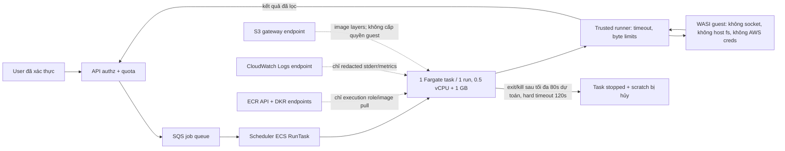
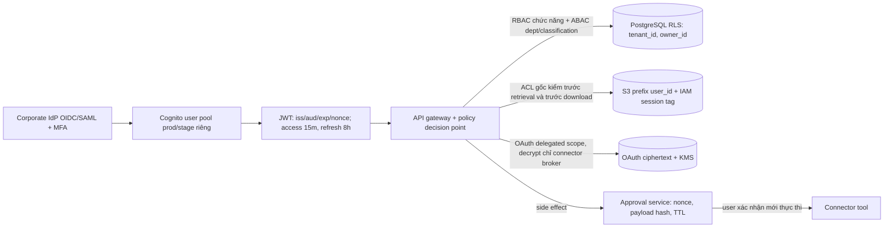

# Tú — Security, Sandbox, Governance & Operations

Ngày chốt giá: **2026-10-16**. Đơn vị: **USD/tháng, chưa VAT**, On-Demand, Region **ap-southeast-1 (Singapore)**, production 2 AZ và staging tách production. Đây là **phần của Tú**, không phải tổng G03; các dòng `network`, database, S3 workspace, model inference/ảnh và app compute của thành viên khác không được cộng lại ở đây. Baseline: 2.000 DAU, 1.760.000 request, 2.376.000 model calls, 400.000 sandbox runs × 30 giây, 90.000 ảnh/tháng. Không trừ ưu đãi hay tín dụng. Nơi số lượng chưa có trong đề (khởi tạo task, text units, log GB, traffic staging), ghi rõ giả định để đo và thay khi chạy pilot.

## 1. Báo giá 5 cột để ghép vào `BaoGia`

Các dòng dưới đây là TSV thật, giữ đúng 5 cột `Component | Ý nghĩa | Ghi chú | Chi phí/tháng | Bằng chứng`. `TOTAL` cuối là **subtotal của Tú**; khi ghép vào file báo giá chung chỉ lấy các dòng thành phần, không dán `TOTAL` này. Mã E41–E53 có trong bảng bằng chứng bên dưới; ảnh trong `Tu_evidence/` cần dán vào cột E cùng dòng mã tương ứng ở sheet `BangChung`.

```tsv
Component	Ý nghĩa	Ghi chú	Chi phí/tháng	Bằng chứng
sandbox	Fargate sandbox production	ECS Fargate Linux/ARM ap-southeast-1; SKU SFSC5A7DP37FRTNX 0.04045 USD/vCPU-giờ và U4BJMTG9K96ZW3HA 0.00442 USD/GB-giờ; 400000 task × max(60,45 khởi tạo + 30 chạy + 5 dọn)=80 giây × (0.5 vCPU + 1GB) = 219.07; 20GB ephemeral/task đã gồm trong SKU.	219.07	E41; E42
sandbox	Fargate sandbox staging	Cùng SKU Fargate Linux/ARM ap-southeast-1; giả định 20000 lượt kiểm thử/tháng × 80 giây × (0.5 × 0.04045 + 1 × 0.00442) USD/giờ = 10.95; tách ECS cluster và subnet production.	10.95	E41; E42
sandbox	VPC endpoints riêng cho sandbox	Amazon VPC Interface Endpoint ap-southeast-1 SKU ZW3HVQKP8FYZ6Y6K 0.013 USD/endpoint-giờ × 3 loại (ECR API ECR DKR CloudWatch Logs) × 2 AZ × 730 giờ = 56.94; SKU 5APZT8JXA5B8ZYFH 0.01 USD/GB × 50GB = 0.50; S3 gateway endpoint không tính thêm; chỉ tính ở Tú, không tính lặp network của Thành.	57.44	E43
authn	SSO doanh nghiệp và MFA	Cognito User Pools SAML/OIDC federation SKU enterprise federated MAU ap-southeast-1 0.015 USD/MAU × (2000 production + 50 tài khoản staging hoạt động) = 30.75; MFA WebAuthn/TOTP bắt buộc tại corporate IdP, không dùng SMS.	30.75	E44
authz	RBAC ABAC và ACL tài liệu	Policy engine và PostgreSQL RLS nằm trong app compute và database của Thành; không có SKU AWS phát sinh riêng; chi phí nằm trong các dòng compute/database, cần kiểm thử deny-by-default và ACL theo quyền gốc.	0	E45
secrets_kms	KMS customer-managed keys	AWS KMS symmetric CMK ap-southeast-1: 2 keys × 1.00 USD/key-tháng = 2.00; 100000 Encrypt/Decrypt/GenerateDataKey requests × 0.03 USD/10000 = 0.30; SKU KMS key storage và symmetric requests.	2.30	E46
secrets_kms	Secrets Manager service secrets	AWS Secrets Manager ap-southeast-1: 15 service secrets prod+stage × 0.40 USD/secret-tháng = 6.00; 100000 API calls × 0.05 USD/10000 = 0.50; OAuth token từng user lưu ciphertext trong DB bằng envelope KMS, không tạo 2000 secrets tính sai giá.	6.50	E47
governance	Bedrock text input output guardrails	Bedrock Guardrails ap-southeast-1 SKU content filter 0.15 và sensitive-information filter 0.10 USD/1000 text units; 2376000 model calls × (1 input + 2 output units) = 7128000 units × 0.25/1000 = 1782.00; một unit tối đa 1000 ký tự, đo lại khi pilot.	1782.00	E48
governance	Kiểm tra prompt injection connector	Bedrock InvokeGuardrailChecks prompt-attack SKU 0.08 USD/1000 text units; giả định 40% × 1760000 request có email/document/tool data × 2 units = 1408000 units, chi phí 112.64; kiểm tra riêng trước khi đưa tool result vào model.	112.64	E48; E49
governance	Lọc ảnh đầu ra	Bedrock Guardrails image content filter SKU 0.00075 USD/ảnh × 90000 ảnh đầu ra = 67.50; dùng ApplyGuardrail riêng nếu image model không tích hợp, Singapore hiện ở preview/chỉ hỗ trợ 4 nhóm nội dung; không tính lại phí sinh ảnh của Phúc.	67.50	E48
governance	Eval gate staging guardrails	Bedrock Guardrails content+PII filters ap-southeast-1 0.25 USD/1000 text units × 1000 bộ test model/prompt × 3 units = 0.75; model inference của test do Phúc báo giá, không nằm dòng này.	0.75	E48
governance	CloudTrail S3 data events	AWS CloudTrail data events delivered to S3 SKU 0.10 USD/100000 events × giả định 3000000 object-level events/tháng = 3.00; chỉ bật bucket cần audit, không đồng nhất CloudTrail với audit nghiệp vụ.	3.00	E50
governance	Audit 12 tháng S3 Standard	S3 Standard ap-southeast-1 SKU M6MTARCQFUQBQ2V3 0.025 USD/GB-tháng × 18GB steady state (1.5GB/tháng × 12 tháng) = 0.45; bucket audit riêng có Object Lock, không nằm trong 6TB workspace của Thành.	0.45	E51
governance	S3 audit object writes	S3 Standard PUT ap-southeast-1 SKU VHRJWKRHEA6VHEFY 0.005 USD/1000 requests × 3000 batch objects/tháng = 0.015, làm tròn 0.02; batch 1000 sự kiện/object.	0.02	E51
monitoring	CloudWatch log ingest và hot storage	CloudWatch Logs Standard ap-southeast-1 SKU APS1-DataProcessing-Bytes 0.70 USD/GB × 20GB ingest = 14.00; APS1-TimedStorage-ByteHrs 0.03 USD/GB-tháng × 20GB hot retention 30 ngày = 0.60; prod+stage, log đã redacted.	14.60	E52
monitoring	CloudWatch custom metrics và alarms	CloudWatch ap-southeast-1 SKU APS1-CW:MetricMonitorUsage 0.30 USD/metric-tháng × 30 metrics = 9.00; SKU APS1-CW:AlarmMonitorUsage 0.10 USD/alarm-tháng × 10 alarms = 1.00; dùng EMF dimensions giới hạn cardinality, không tạo metric riêng cho 2000 user.	10.00	E52
monitoring	X-Ray sampled traces	CloudWatch X-Ray ap-southeast-1 SKU APS1-XRay-Spans-Indexed 0.00000075 USD/indexed span × 1760000 request × 10% sampled × 5 spans = 0.66; trace không ghi prompt hay token gốc.	0.66	E52
cicd	CodePipeline production staging	AWS CodePipeline V1 ap-southeast-1 SKU active pipeline 1.00 USD/pipeline-tháng × 1 pipeline có 2 deployment stages = 1.00; IaC Terraform/CDK nằm trong CodeBuild, không nhân đôi phí stage.	1.00	E53
cicd	CodeBuild security eval deployment	AWS CodeBuild Linux general1.small ap-southeast-1 SKU 0.005 USD/build-minute × 200 phút/tháng = 1.00; bao gồm test SAST dependency IaC policy và eval gate, không bao gồm token inference của Phúc.	1.00	E53
cicd	ECR image registry	Amazon ECR private repository ap-southeast-1 SKU 7V2YHG7PQ82BEXNB storage 0.10 USD/GB-tháng × 10GB image prod+stage = 1.00; pin image digest và quét bằng Trivy trong CodeBuild, không dùng Inspector ngoài báo giá.	1.00	E53
TOTAL	Tổng riêng các component của Tú	Cộng các dòng trên theo USD/tháng; 2321.63 là subtotal phần Tú, không phải hóa đơn toàn G03 và bỏ dòng này khi ghép BaoGia chung.	2321.63	E41; E53
```

Phép tính có thể kiểm lại: sandbox compute `420000 × 80/3600 × (0.5×0.04045 + 0.00442) = 230.02`; endpoint `6×730×0.013 + 50×0.01 = 57.44`; authn `2050×0.015 = 30.75`; KMS/Secrets `8.80`; governance `1966.36`; monitoring `25.26`; CI/CD `3.00`; tổng `2321.63`. Nếu task khởi tạo/chạy/dọn ≤60 giây, mức sàn compute là `420000×60/3600×0.024645 = 172.52`, **không** phải 420000×30 giây. Nếu thời gian hóa đơn bình quân tăng 100 giây, compute lên `287.53`; endpoint không đổi. Giá guardrails dao động theo số ký tự thực và tỷ lệ có connector, không theo token model; dashboard phải đo text units riêng. 20GB CloudWatch ingest là **ngân sách**, phải log sampling/redaction; vượt ngân sách thì tăng theo giá/GB chứ không bỏ log bảo mật.

## 2. Bằng chứng giá và ảnh chụp

Các liên kết JSON là **AWS public Price List API đúng Region**, cung cấp SKU, region, đơn giá; ảnh PNG trang giá AWS được chụp thật ngày 2026-10-16. [Ảnh tổng hợp SKU Singapore](/home/tu/VinLab/K4-VBot/Tu_evidence/E-CATALOG-01_singapore_skus.png) là **ảnh kết xuất tự động từ JSON AWS đã tải, không phải ảnh AWS Console**; nó hiển thị SKU/region/rate để giảng viên đối chiếu với URL gốc. Trang HTML AWS thường không in SKU nội bộ; khi ghép `BangChung`, đưa **cả URL catalog, ảnh trang giá và ảnh kết xuất SKU** vào cùng hàng. Giá trang chung có thể hiển thị ví dụ US East nên **chỉ lấy đơn giá Singapore từ JSON catalog**, trừ Cognito/Bedrock/CloudTrail là biểu giá toàn vùng của trang dịch vụ. Ảnh không phải hóa đơn AWS hay phép đo workload.

| E-code | Mô tả và ảnh thực tế | Link nguồn giá AWS | Ngày chụp |
|---|---|---|---|
| E41 | Fargate Linux/ARM, 60s minimum, billed từ image pull; [ảnh](/home/tu/VinLab/K4-VBot/Tu_evidence/E-SBX-01_fargate.png) | [Fargate pricing](https://aws.amazon.com/fargate/pricing/) | 2026-10-16 |
| E42 | Fargate ARM `APS1-Fargate-ARM-vCPU-Hours:perCPU` và `APS1-Fargate-ARM-GB-Hours`; [ảnh trích SKU/rate](/home/tu/VinLab/K4-VBot/Tu_evidence/E-CATALOG-01_singapore_skus.png) | [AmazonECS Singapore catalog](https://pricing.us-east-1.amazonaws.com/offers/v1.0/aws/AmazonECS/current/ap-southeast-1/index.json) | 2026-10-16 |
| E43 | VPC endpoint hour/GB `APS1-VpcEndpoint-*`; [ảnh trích SKU/rate](/home/tu/VinLab/K4-VBot/Tu_evidence/E-CATALOG-01_singapore_skus.png) | [AmazonVPC Singapore catalog](https://pricing.us-east-1.amazonaws.com/offers/v1.0/aws/AmazonVPC/current/ap-southeast-1/index.json), [VPC pricing](https://aws.amazon.com/vpc/pricing/) | 2026-10-16 |
| E44 | Cognito enterprise federation 0.015 USD/MAU; [ảnh](/home/tu/VinLab/K4-VBot/Tu_evidence/E-AUTH-01_cognito.png) | [Cognito pricing](https://aws.amazon.com/cognito/pricing/) | 2026-10-16 |
| E45 | IAM và RLS là cơ chế trong compute/DB hiện hữu, không có line item riêng; [AWS IAM pricing](https://aws.amazon.com/iam/pricing/) | [IAM pricing](https://aws.amazon.com/iam/pricing/), [PostgreSQL RLS](https://www.postgresql.org/docs/current/ddl-rowsecurity.html) | 2026-10-16 |
| E46 | KMS key và API requests; [ảnh](/home/tu/VinLab/K4-VBot/Tu_evidence/E-KMS-01_kms.png) | [awskms Singapore catalog](https://pricing.us-east-1.amazonaws.com/offers/v1.0/aws/awskms/current/ap-southeast-1/index.json), [KMS pricing](https://aws.amazon.com/kms/pricing/) | 2026-10-16 |
| E47 | Secrets Manager secret-month và API calls; [ảnh](/home/tu/VinLab/K4-VBot/Tu_evidence/E-SEC-01_secrets.png) | [AWSSecretsManager Singapore catalog](https://pricing.us-east-1.amazonaws.com/offers/v1.0/aws/AWSSecretsManager/current/ap-southeast-1/index.json), [pricing](https://aws.amazon.com/secrets-manager/pricing/) | 2026-10-16 |
| E48 | Guardrails content/PII/image và text unit; [ảnh](/home/tu/VinLab/K4-VBot/Tu_evidence/E-GOV-01_guardrails.png) | [Bedrock pricing — Guardrails](https://aws.amazon.com/bedrock/pricing/) | 2026-10-16 |
| E49 | `InvokeGuardrailChecks` prompt-attack 0.08 USD/1000 units; [ảnh](/home/tu/VinLab/K4-VBot/Tu_evidence/E-GOV-02_prompt_attack.png) | [Bedrock pricing — InvokeGuardrailChecks](https://aws.amazon.com/bedrock/pricing/) | 2026-10-16 |
| E50 | CloudTrail data events 0.10 USD/100k; [ảnh](/home/tu/VinLab/K4-VBot/Tu_evidence/E-AUD-01_cloudtrail.png) | [CloudTrail pricing](https://aws.amazon.com/cloudtrail/pricing/) | 2026-10-16 |
| E51 | S3 Standard GB-month và PUT SKU; [ảnh](/home/tu/VinLab/K4-VBot/Tu_evidence/E-AUD-02_s3.png) | [AmazonS3 Singapore catalog](https://pricing.us-east-1.amazonaws.com/offers/v1.0/aws/AmazonS3/current/ap-southeast-1/index.json), [S3 pricing](https://aws.amazon.com/s3/pricing/) | 2026-10-16 |
| E52 | CloudWatch Logs/metrics/alarms/X-Ray SKU; [ảnh](/home/tu/VinLab/K4-VBot/Tu_evidence/E-MON-01_cloudwatch.png) | [AmazonCloudWatch Singapore catalog](https://pricing.us-east-1.amazonaws.com/offers/v1.0/aws/AmazonCloudWatch/current/ap-southeast-1/index.json), [pricing](https://aws.amazon.com/cloudwatch/pricing/) | 2026-10-16 |
| E53 | Pipeline/Build/ECR; [ảnh CodeBuild](/home/tu/VinLab/K4-VBot/Tu_evidence/E-CICD-01_codebuild.png) | [CodePipeline catalog](https://pricing.us-east-1.amazonaws.com/offers/v1.0/aws/AWSCodePipeline/current/ap-southeast-1/index.json), [CodeBuild catalog](https://pricing.us-east-1.amazonaws.com/offers/v1.0/aws/CodeBuild/current/ap-southeast-1/index.json), [ECR catalog](https://pricing.us-east-1.amazonaws.com/offers/v1.0/aws/AmazonECR/current/ap-southeast-1/index.json) | 2026-10-16 |

## 3. Quyết định kỹ thuật, ranh giới tin cậy và tải đỉnh

### Sandbox

| Phương án | Cô lập | Vận hành/chi phí | Kết luận |
|---|---|---|---|
| Container Docker thuần trên EC2 | Chung kernel host; nguy cơ kernel/container escape ảnh hưởng đồng tenant | Rẻ ở tải ổn định nhưng phải giữ host pool, vá và xóa state | Không dùng cho code AI không tin cậy. |
| gVisor `runsc` trên EKS/EC2 | Chặn nhiều syscall bằng user-space kernel, vẫn có shared host kernel ở lớp ngoài | Cần node pool/K8s, phí host/EKS và quản lý runtime | Dự phòng khi cần POSIX rộng hơn WASI. |
| Firecracker microVM trên EC2 | Guest kernel riêng, có thể bỏ hẳn NIC cho guest | Cần tự xây image/snapshot scheduler, capacity/patch/forensics; không có giá AWS managed cho từng microVM | Bảo mật mạnh, nhưng chưa chốt nếu chưa có benchmark startup/cost. |
| Kata trên EKS/EC2 | VM riêng cho pod, lớp kernel host giảm chia sẻ | EKS+host pool và RuntimeClass/Kata vận hành phức tạp | Không chọn cho baseline 400k lượt ngắn. |
| **ECS Fargate task + WASI/Wasmtime guest** | Mỗi task có ranh giới Fargate riêng; guest WASI chỉ được stdin/stdout và scratch giới hạn, **không cấp socket/host path** | On-Demand ARM, scale-to-zero, tính task tối thiểu 60s; giới hạn là chỉ code/ thư viện hỗ trợ WASI | **Chọn cho Python/JS tác vụ sandbox đã đóng gói WASM**; native binaries không được tự động nhận. |

Fargate cô lập task nhưng **container cùng task không phải security boundary**; vì vậy runner đáng tin cậy và guest WASM cùng task, còn mỗi lượt không tin cậy là một task mới. Không nhận mã native hay `pip install` lúc chạy; gói thư viện được build, scan, ký và allowlist trong CI. Nếu yêu cầu chạy native code bất kỳ, phải chuyển sang Firecracker/Kata và **báo giá lại**, không tuyên bố Fargate+WASI hỗ trợ.



`RunTask` dùng subnet private **không route NAT/IGW**, không public IP, SG inbound chỉ từ dispatcher theo cổng runner mTLS; sau khi ECS trả task ENI, dispatcher đẩy code/input qua kết nối mTLS ngắn hạn tới runner, **không truyền code qua environment variable hoặc S3 public URL**. Outbound của **task** chỉ HTTPS tới ECR API/DKR và CloudWatch Logs endpoints, S3 gateway cho image layers, endpoint policy thu hẹp repo/log group. Điều này **không có nghĩa ENI không egress tuyệt đối**: bootstrapping vẫn cần các endpoint AWS. Điều kiện H3 được áp tại **guest code**: Wasmtime không import `wasi:sockets`, không preopen filesystem host, không env chứa credential, deny toàn bộ socket/HTTP; cố gọi `169.254.169.254`, `169.254.170.2`, RFC1918 hay host path không có capability để thực hiện. Task **không gắn task IAM role**; execution role pull ECR/write log không lộ trong container. Chặn max 120 giây wall-clock (kể cả 30 giây compute target), 0.5 vCPU, 1GB RAM, output 1MB, scratch 256MB, kill task khi quá hạn; kết quả đi qua runner và quét DLP. Log VPC Flow Logs + cảnh báo nếu có kết nối ngoài allowlist. Không mount workspace/S3/token vào task.

Tải: tỷ lệ sandbox `400000/1760000 = 22.73%`. Đỉnh 7 request/s của nhóm → `1.59 run/s`. Với **80s task lifetime** cần `ceil(1.59×80)=128 task đồng thời`, 64 task/AZ, tương đương 64 vCPU và 128GB RAM. Thiết kế queue nhận back-pressure, autoscale scheduler và test ở 128/192 task (failover một AZ); sau mất một AZ, 128 task dồn AZ còn lại. [Quota Fargate On-Demand mặc định 6 vCPU](https://docs.aws.amazon.com/general/latest/gr/ecs-service.html), **phải xin ≥96 vCPU trước pilot và kiểm tra quota thực cấp**; 128 task ×0.5 =64 vCPU, thêm 50% headroom =96. Launch rate region có giới hạn, test ramp-up và p95 queue wait riêng; 10 phút agent background phải bao gồm queue + execute + notify, không được suy từ giá. Số 45s khởi tạo là giả định, cần đo p50/p95 image pull trong pilot.

### SSO, quyền dữ liệu, token



- SSO doanh nghiệp qua Cognito federation tới IdP; MFA **enforce ở IdP** và chỉ nhận claim `amr/acr` đúng policy, fail-closed nếu thiếu. Authorization Code + PKCE, cookie `Secure`, `HttpOnly`, `SameSite=Lax`, CSRF state/nonce, rotate refresh token ở IdP/app, revoke khi logout/đổi vai trò; validate JWT `iss`, `aud`, chữ ký JWKS, `exp`, `nbf`, không tin `department/role` từ client. Prod/stage khác pool, client ID, KMS key, DB và bucket; staging không chứa dữ liệu prod.
- RBAC cho chức năng (`employee`, `manager`, `admin`, `security_auditor`) kết hợp ABAC `tenant_id`, `dept_id`, `classification`, `owner_id` và `source_acl_version`; **deny by default**. Quyền admin vận hành không tự cấp quyền đọc tài liệu. Agent chỉ là đại diện của user (`user_id`, delegated scopes, expiry), không có quyền độc lập.
- Phối hợp Thành: DB bảng `documents(id, tenant_id, owner_id, source_id, source_acl, acl_version, classification, deleted_at)`, `chunks(document_id, ...)`, `agent_runs(user_id, ...)`, `oauth_grants(user_id, provider, scopes, ciphertext, expires_at)`; mọi bảng bật RLS, service DB role không `BYPASSRLS`. Retrieval lọc `tenant/ACL` **trước** vector top-K để tránh lọt kết quả và kiểm lại ACL theo nguồn ngay trước trả/download; revoke ACL kéo theo invalidate index/cache. `s3://.../users/{user_id}/...`, quota 10GB qua usage counter giao dịch + hard limit trước PUT, S3 bucket policy với principal/session tag và object ARN prefix; backend phải assume role theo user, không dùng một IAM role đọc toàn bucket. Presigned URL ngắn hạn chỉ sau authz và gắn đúng object/version. Không dùng KMS key riêng từng user; 2 CMK là prod/stage, quyền tách bằng IAM+encryption context `tenant_id`, `user_id`.
- OAuth connector: scope tối thiểu (`mail.read` tách `mail.send`, `files.read` tách `files.delete`), token per-user mã hóa envelope (`GenerateDataKey`/AES-GCM, encryption context user/provider); ciphertext trong DB, data key plaintext chỉ trong memory broker trong vài giây. Chỉ **connector broker role** có `kms:Decrypt` với context đúng và Secrets Manager read cần thiết; AI model, sandbox, frontend, CI role không decrypt. Refresh token rotate/revoke, phát hiện reuse, không log header/token; CloudTrail KMS/Secrets API + app audit theo `actor_user_id`.

### AI/Data Governance, monitoring và release gate

- Trước inference: phân loại `Public/Internal/Confidential/Restricted`, chặn đưa Restricted vào model nếu policy chưa duyệt; DLP regex + Bedrock sensitive-info filter che PII, secret và key; chỉ lưu mapping redaction trong vùng server có TTL. Bedrock Guardrails input/output (content + PII); ảnh đầu ra gọi `ApplyGuardrail` nếu model ảnh không tích hợp, lưu ý [image filtering tại Singapore hiện chỉ ở preview cho Hate/Insults/Sexual/Violence](https://docs.aws.amazon.com/bedrock/latest/userguide/guardrails-mmfilter.html). Connector email/doc/tool result là **untrusted data**, bọc ranh giới nguồn, chạy `InvokeGuardrailChecks` riêng vì [tool results trong `toolResult` không được prompt-attack filter mặc định kiểm](https://docs.aws.amazon.com/bedrock/latest/userguide/guardrails-prompt-attack.html). Không tin chỉ một classifier: tool allowlist, schema validation, domain recipient allowlist và policy side-effect quyết định ngoài LLM.
- Trước `send_email`, `create_ticket`, `delete_file`: tạo action proposal chứa recipient/path, attachment hashes, nội dung sẽ gửi, quyền nguồn, TTL 5 phút; UI hiển thị và yêu cầu người dùng xác nhận, ký approval nonce gắn `user_id+action+payload_hash`. Executor chỉ chấp nhận nonce một lần sau khi **re-authorize**; đổi một byte/hết TTL/đổi ACL thì yêu cầu lại. Với xóa file: soft-delete/quarantine + khôi phục theo retention, không hard-delete ngay.
- H8: dataset có mẫu Việt/Anh, email injection, cross-user ACL, PII leak, sandbox escapes, lỗi connector; mỗi cấp tác vụ ≥95% điểm model tham chiếu do Phúc chọn, đồng thời không regression safety (`0` high-severity exfiltration trong bộ test). CI eval trước mọi model/prompt/guardrail version; report có baseline, diff, owner approval; canary 5% và rollback. **Chọn Guardrails Standard** cho tiếng Việt vì [Classic chỉ hỗ trợ English/French/Spanish, Standard hỗ trợ Vietnamese](https://docs.aws.amazon.com/bedrock/latest/userguide/guardrails-supported-languages.html). Standard [dùng cross-Region inference](https://docs.aws.amazon.com/bedrock/latest/userguide/guardrails-tiers.html): guardrail cấu hình ở Singapore nhưng prompt/output có thể được xử lý ở Region khác trong cùng geography. Phải được doanh nghiệp duyệt data residency trước go-live, ghi đúng Region đích và test H8; nếu bắt buộc mọi byte ở Singapore thì thiết kế Guardrails Standard này **chưa đáp ứng**, phải thay bộ lọc đa ngôn ngữ xử lý tại chỗ rồi báo giá lại, không âm thầm dùng Classic.
- At rest: S3 SSE-KMS, DB TDE/KMS, OAuth envelope encryption; in transit TLS 1.2+ và PrivateLink nơi khả dụng. Bedrock theo [AWS FAQ](https://aws.amazon.com/bedrock/faqs/) không dùng input/output để train và không chia sẻ với model providers; **kiểm thêm retention mode/model-specific terms** trước duyệt model, không bật invocation logging chứa prompt và đặt `store=false` nếu dùng Responses API. Dữ liệu người dùng: bản chính theo chính sách doanh nghiệp (đề xuất xóa 30 ngày sau offboarding), soft-delete 30 ngày rồi hard-delete, cache/PII mapping 24 giờ, log ứng dụng 30 ngày hot, audit 12 tháng Object Lock + lifecycle; legal hold là ngoại lệ được phê duyệt. S3 audit/object data events + app audit `who/what/when/resource/decision`, không lưu payload nhạy cảm; kiểm restore và verify hash định kỳ.
- Monitoring: request/model/tool/sandbox latency p50/p95, token input/output, lỗi 4xx/5xx/throttle, guardrail blocks, ACL denies, sandbox timeout/egress attempts, queue depth, cost actual/forecast. EMF log chỉ hashed/pseudonymous `user_id`, `dept_id`, `model_id`, token counts và billed text units; **không** ghi prompt, email body, attachment, token OAuth, key hay full S3 path. Aggregate cost per user/department trong DB/report từ Bedrock usage + các dòng infra phân bổ, không tạo metric cardinality 2000 users. Alarm: budget 50/80/100%, token spikes, >5% errors, p95 TTFT >3s, 10-minute job SLA, quota 80%, KMS decrypt anomaly. AWS Budgets budget-alert email có thể có phụ phí nếu dùng action; báo giá này chỉ bao gồm CloudWatch alarms, **chưa đưa một SKU Budgets Action không xác minh vào tổng**. Khi vượt budget: chặn image/agent cấp cao theo quota, giữ chức năng chat thiết yếu; không tắt audit/DLP.
- CI/CD: GitHub PR → CodeBuild unit/integration/SAST/secret scan/dependency & image scan bằng Trivy/IaC policy/eval H8 → pin image digest vào ECR → CodePipeline deploy staging → smoke + sandbox escape/ACL tests → manual approval → canary prod → metric rollback. IAM OIDC short-lived for CI, không dùng AWS long-lived key. Staging tách tài khoản hoặc ít nhất VPC/role/bucket/DB/Cognito/KMS; giá app/DB staging do chủ component tính, **Tú đã tính sandbox staging và 50 MAU staging**. IaC xác nhận endpoint policies, no NAT route ở sandbox, CloudTrail Object Lock, alarms và quota request.

## 4. Nội dung 3 slide (dùng trực tiếp)

**Slide 1 — Workspace & Sandbox**

1. Workspace 10GB/người; `tenant_id/user_id` được enforce bằng PostgreSQL RLS, S3 scoped session/prefix và ACL nguồn kiểm trước retrieval + trước download (ghép sơ đồ 3 dòng DB/S3 của Thành).
2. Code AI → 1 Fargate task/lượt → WASI không socket/host path/IAM → timeout/CPU/RAM/output limit → hủy task; subnet không NAT/IGW, chỉ endpoint boot ECR/Logs.
3. 400k lượt × 30s: tính **80s billable** gồm 45s startup + 5s cleanup, sàn AWS 60s; đỉnh 128 task/64 vCPU, phải tăng quota ≥96 vCPU và load-test 2 AZ.

**Slide 2 — AI & Data Governance**

1. OIDC/SAML + MFA; RBAC/ABAC, delegated OAuth scope; KMS chỉ connector broker giải mã token đúng user/context.
2. Guardrails input/output + DLP PII; email/doc/tool result bị xem là dữ liệu không tin cậy, kiểm prompt attack riêng; send/ticket/delete cần approval nonce ràng payload và re-authz.
3. Phân loại dữ liệu, TLS/SSE-KMS, audit Object Lock 12 tháng; Bedrock không train bằng input/output, kiểm retention mode; đổi model/prompt phải qua H8 eval gate của Phúc.

**Slide 3 — Monitoring & FinOps**

1. CloudWatch p95 latency/TTFT, tokens, lỗi, queue, sandbox blocks, trace sampled; log ẩn PII/prompt/token, audit 12 tháng riêng.
2. Chargeback user/department bằng usage ledger; quota/budget 50–80–100%, giảm tác vụ đắt trước, không tắt kiểm soát an toàn.
3. CI/CD staging tách production: scan → test ACL/escape → H8 eval → approval → canary/rollback; Tú subtotal **2321.63 USD/tháng**, giả định text units/khởi tạo phải đo pilot.

## 5. Trả lời hội đồng

**Email chứa prompt injection yêu cầu gửi hợp đồng ra ngoài?** Email đi vào kênh `untrusted` có source/ACL, được prompt-attack check trước khi đưa vào model; instruction trong body không trở thành system instruction. Model chỉ được đề xuất hành động. Policy engine chặn recipient ngoài allowlist/classification, DLP quét hợp đồng/PII, và `send_email` không có approval nonce một lần gắn đúng `recipient+attachment hash+body` thì executor không gửi. Người dùng nhìn thấy đầy đủ email và phải xác nhận; nếu có sửa nội dung hay ACL đổi, xác nhận cũ vô hiệu. Ghi audit quyết định, không ghi nội dung hợp đồng.

**Code sandbox cố thoát host hoặc gọi metadata endpoint?** Code chạy trong WASI guest không được cấp socket, host path hay AWS credential nên không gọi được metadata `169.254.169.254`/ECS `169.254.170.2`; Fargate task là lớp tách kernel/ENI với task khác, không mount host hay workspace. Runner giới hạn 0.5 vCPU/1GB/120s và hủy cả task, scratch biến mất. Subnet không Internet/NAT; chỉ execution agent dùng VPC endpoints để pull image/log, task role để trống. Cảnh báo VPC Flow Logs/attempts và test escape suite trong staging; không khẳng định zero-risk nếu Wasmtime/Fargate có lỗ hổng mới, phải vá và kiểm định định kỳ.

**Agent A cố đọc file nhân viên B?** Agent A không có identity độc lập hay token của B; request mang principal A. PostgreSQL RLS lọc `tenant_id/owner_id/source_acl` trước vector top-K, kiểm lại source ACL lúc đọc; S3 signed URL chỉ cấp sau authz và role/session tag của A chỉ cho ARN `users/A/*`. Bất kỳ truy vấn DB/S3 trực tiếp bị deny; KMS context không cấp decrypt token B. ACL revoke làm invalid cache/index; deny được audit. Test negative cross-user (direct path, vector search, stale URL, forged session tag) trong CI trước deploy.

## 6. Việc team cần nối và rủi ro chưa được chứng minh

- **Thành**: không tính lặp 6 interface endpoints ở dòng network; bổ sung DB RLS/ACL schema, S3 `user_id` prefix + scoped STS và 10GB hard quota, audit bucket riêng 18GB/12mo. Team network hiện có NAT cho app nhưng **sandbox subnet phải không có route NAT**.
- **Phúc**: Bedrock model/image inference không trùng phí Guardrails 1962.14 ở đây; cung cấp model reference/H8 dataset, kiểm model availability/data retention, đo text units/ảnh moderation thực tế. Nếu model/prompt khác cần thay giả định 1+2 units/call. Xác nhận với nhóm việc Guardrails Standard có xử lý cross-Region trong APAC trước khi chốt H1/H5.
- **Nhóm ghép báo giá**: thay các dòng hiện tại đang dùng Fargate 30s, Cognito 0.0055 USD/MAU, CloudWatch 0.50 USD/GB và governance 0; các số đó không tương thích bằng chứng Singapore/Guardrails. Sau ghép kiểm `TOTAL` chung và `BangChung` ảnh thật. Giá không bao gồm thuế, support plan, labor, VPC Flow Logs ingest vượt 20GB, phí egress ngoài VPC, Budgets Action, 12-mo S3 audit có legal hold dài hơn hoặc tăng tỷ lệ prompt dài. Không thể cam kết chi phí/sức tải đỉnh trước pilot 128/192 task và quota approval.
