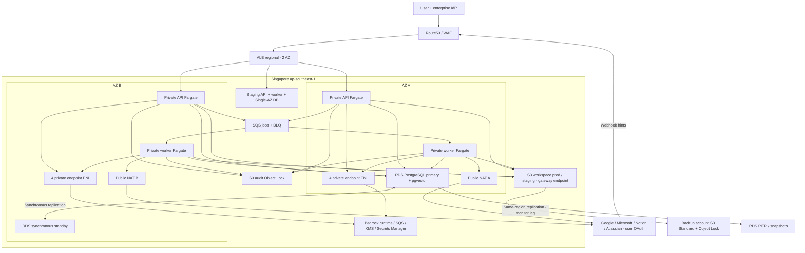
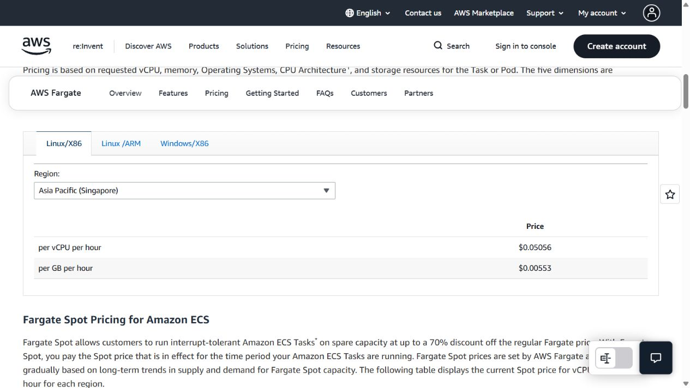
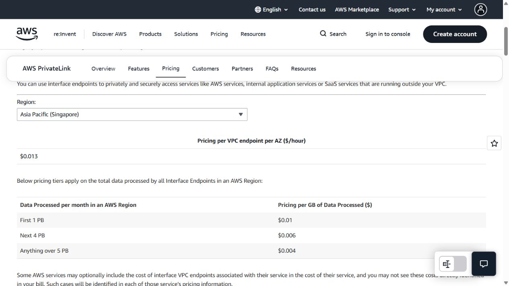

# THÀNH — Cloud, Database & Data — VBot Workplace G03

Ngày lập/xác minh: **16/10/2026, Asia/Saigon**. USD/tháng, On-Demand, chưa VAT. **Subtotal đã định giá: 1,436.46 USD tại 2.000 DAU; 2,520.57 USD tại 4.000 DAU**, tăng 1,084.11 USD. Có production, staging, backup, diễn tập và mạng. Đây là subtotal phần Thành; còn các dòng **PENDING** và chi phí của nhóm Model/Tú/Phúc. Bản bàn giao để Phúc ghép báo giá chung.

## 1. Phạm vi và giả định để tính lại

- AWS `ap-southeast-1`, hai AZ cho production; 730 giờ cho tài nguyên liên tục, 220 giờ hành chính. Staging compute/DB 224 giờ gồm 4 giờ khởi động/drain, staging storage 730 giờ. Staging Single-AZ được chọn để tiết kiệm; không mang SLO production.
- 2.000 DAU, 1.760.000 request/tháng, đỉnh 6,67 request/s; 2.376.000 model calls/tháng. Không chạy model/GPU tại ECS. Bedrock token, embedding, ảnh, rerank và sandbox tính ở phần khác.
- **Quy ước bảo thủ dung lượng:** đề bài ghi GB/TB; bảng này budget 3 GiB/user và 6.000 GiB production, 100 GiB staging. 6.000 GiB là 6,442 TB decimal, cao hơn 6 TB decimal; không gọi 6 TB là 6 TiB. Quota 10 GiB/user, sức chứa quota tối đa 20.000 GiB, không trả trước cho phần chưa sử dụng. AWS S3/Fargate quy đổi GB theo 2^30 byte; nếu nhóm chốt decimal thì phải chuyển đổi nhất quán.
- 1 triệu chunk, 1024 chiều float32, trung bình 500 chunk/user là **giả định sizing**, không suy từ 6 TB. Ở 4k: 3,52m request, 4,752m model calls, đỉnh 13,34 request/s, 12.000 GiB current, 2m chunk. Staging giữ nguyên.
- Sizing không phải kết quả benchmark. Số liệu mạng/request/log là **ngân sách có đơn giá xác minh**, phải thay bằng số đo và không được mô tả là usage AWS đã ghi nhận.
- Không khấu trừ free tier, credits, trial, Savings Plans, Reserved, Spot, Internet egress allowance hoặc backup allocation. Backup tính gross 350 GiB nhằm tránh dựa vào phần không thu phí đi kèm. Dịch vụ không thu phí cấu phần riêng như VPC, S3 gateway endpoint, ECS orchestration/ACM tích hợp là cơ chế giá thông thường, không phải ưu đãi tài khoản.
- Đã đọc nguyên văn H1–H8 trong `K4-VBot/docs/vbot-capstone.html:374–381` khi rà repo ngày16/10/2026. H7 không ghi bắt buộc DR liên region; baseline phục hồi cùng Singapore phải được kiểm thử theo phạm vi sự cố công bố. Không tuyên bố đã chứng nhận toàn bộ H1–H8 chỉ nhờ bản thiết kế.

## 2. Phương án và lý do chọn công nghệ

| Công nghệ | Lý do chọn | Điều kiện/giới hạn |
|---|---|---|
| ECS Fargate Linux/x86 | Không quản node; async API/connector/agent nhỏ; trả CPU/RAM theo task, giảm worker ngoài giờ; không cần EKS control plane/operator | Không chứng minh là phương án rẻ nhất mọi workload; ARM có thể giảm ~20% compute sau kiểm tra image; baseline chọn x86 để đồng nhất thư viện |
| RDS PostgreSQL Multi-AZ + pgvector | Một DB cho metadata/chat/ACL/vector, managed backup và standby; không vận hành thêm vector cluster | Chọn r6g tránh burst credit; Aurora cần writer+reader HA và meter ACU/I/O riêng; không gọi Aurora chắc chắn đắt hơn khi chưa có workload test |
| S3 Standard + versioning + replica | Phục vụ file nhanh, bền vững theo nhiều AZ, backup có thể đọc ngay | Không dùng Deep Archive cho bản phục hồi RTO 4h; vẫn phải trả replica/request/KMS |
| Hybrid connector | Index cho tìm kiếm dài/chéo nguồn; gọi trực tiếp cho mail/calendar mới và thao tác ghi | ACL nguồn kiểm lại trước LLM; mất nguồn có thể giảm khả dụng retrieval |
| Cache RAM + SQS | Không cần Redis HA với session/job bền vững trong DB; SQS tách nền và chịu sự cố AZ | Cache mất được; không dùng cache làm khóa/quota hoặc nơi lưu kết quả duy nhất |
| ALB/WAF + 2 NAT + PrivateLink | Health routing 2 AZ, egress mỗi AZ độc lập; Bedrock/SQS/KMS/Secrets dùng private endpoint | Endpoint có phí mỗi service mỗi AZ; vẫn cần NAT cho SaaS và ECR/control APIs |

## 3. Compute: task, tài nguyên, autoscaling

Sơ đồ cloud/data (staging tách dữ liệu/quyền, dùng chung dịch vụ mạng đã ghi chi phí):



Control/credential plane của Tú nối vào task role/vault; schema này không thay thế thiết kế bảo mật chi tiết. RDS primary có thể ở AZ nào sau failover; hình là trạng thái ban đầu.

| Service | 2.000 DAU | 4.000 DAU | CPU/RAM mỗi task | Thời gian tính |
|---|---:|---:|---|---|
| Prod API/gateway/webhook/scheduler | 2 task, mỗi AZ 1 | 4 task, mỗi AZ 2 | 1 vCPU/2 GiB | 730h |
| Prod agent + connector workers | 2 task, mỗi AZ 1 | 4 task, mỗi AZ 2 | 1 vCPU/2 GiB | 220h |
| Prod worker ngoài giờ | 2 task, mỗi AZ 1 | 2 task, mỗi AZ 1 | 0,25 vCPU/0,5 GiB | 510h |
| Staging API + worker | 2 task | 2 task | 0,5 vCPU/1 GiB | 224h; tắt ngoài lịch |
| Prod task-h dành rolling deploy/scale/drain | 40 | 80 | 1 vCPU/2 GiB | allowance/tháng, phát sinh thêm tính tiếp |

Production giờ hành chính baseline 4 vCPU/8 GiB trên 4 task; ngoài giờ 2,5 vCPU/5 GiB trên 4 task. Không hạ API dưới 2 replica; worker giảm kích thước bằng lịch triển khai task definition, giữ hai AZ. Có thể hoãn bulk ingestion sang giờ hành chính; job đã nhận không bị tắt giữa chừng. Staging dùng lịch khởi động trước giờ làm và drain cuối ngày; RDS có cơ chế tự khởi động sau thời gian stop tối đa, scheduler phải kiểm soát lịch thực tế, không giả định dừng vô hạn.

Task CPU sizing: giả định CPU local 50 ms/request, tại peak `6,67×0,05=0,3335 vCPU`; với target 50% cần 0,667 vCPU, làm tròn một task 1vCPU có thể gánh tải khi mất AZ. Đây chưa gồm mọi overhead; **load test một task gánh 6,67 rps, memory p95 <70%, TTFT p95 ≤3s mới được nghiệm thu**. 30 giây stream bình quân tại peak tạo ~200 kết nối đồng thời; API phải async, budget tối thiểu 256 stream/task, không giữ transaction DB trong khi chờ model.

Worker sizing giả định 5% request thành long job =88.000/tháng, bình quân 120s/job: `88000×120/(220×3600)=13,33` concurrent job. 16 async job slots/task, hai task đủ N-1 theo giả định; nếu job thực tế mất 600s thì cần ~66,67 slots và phải tăng worker. Hệ số job/CPU/thời gian phải đo; 2,376m model calls không bằng số SQS message. Ràng buộc thêm Bedrock RPM/TPM/concurrency và quota provider trước go-live.

Autoscale API min 2/max 12 (4k min4/max24), CPU target50%, RAM70%, request/task và active-stream làm tín hiệu bổ sung; scale-out nhanh, scale-in cooldown300s, drain kết nối. Worker min2 business (4k min4), max12/24; scale theo tuổi message và backlog/job slots, không chỉ CPU. ECS Availability Zone rebalancing và health check phải bật/kiểm tra. Giới hạn concurrency khi DB hoặc Bedrock throttle; dùng connection pool trong app (tối đa 20 connection/API task và 10/worker baseline), không mua RDS Proxy. Lịch prewarm trước giờ làm, không dựa hoàn toàn cold scale. Task-h vượt allowance là usage bổ sung, không bị che bằng một giá cố định.

Tham khảo: [ECS AZ balancing](https://docs.aws.amazon.com/AmazonECS/latest/developerguide/service-rebalancing.html), [Fargate pricing](https://aws.amazon.com/fargate/pricing/), [RDS stop](https://docs.aws.amazon.com/AmazonRDS/latest/UserGuide/USER_StopInstance.html).

## 4. Database, vector và quyền gốc

Prod `db.r6g.large` 2vCPU/16GiB, RDS PostgreSQL Multi-AZ **DB instance với một standby đồng bộ**; primary và standby ở 2 AZ, 100GiB gp3. Standby không phục vụ đọc. Giá 0,54 USD/deployment-h đã gồm hai máy, storage Multi-AZ 0,276/GB-month đã gồm hai bản; không nhân đôi lần nữa. Staging r6g.large Single-AZ 50GiB, có chi phí compute và storage riêng. Phiên bản PostgreSQL được hỗ trợ tiêu chuẩn, tránh Extended Support. Cài [pgvector được RDS hỗ trợ](https://docs.aws.amazon.com/AmazonRDS/latest/PostgreSQLReleaseNotes/postgresql-extensions.html); version extension phải kiểm ở môi trường triển khai.

`1.000.000×1024×4 = 4.096.000.000 byte ≈3,81 GiB` vector thô. Budget 30GiB vector+HNSW+text/metadata, 30GiB chat/job/ACL, 10GiB schema phụ trợ và 30GiB trống =100GiB. HNSW/text overhead này là dự trù; benchmark RAM và EXPLAIN mới xác nhận. 4k 2m vectors, 7,63GiB thô, DB200GiB và r6g.xlarge4vCPU/32GiB. Không coi 6TB file là toàn bộ corpus đã embedding; cần thống kê MIME, text, chunk overlap, ACL multiplicity và tenant duplication. Chọn chiều1024 tương thích Titan Text Embeddings V2; nếu nhóm Model chọn512/256 thì tính lại raw vector và đánh giá recall, không tự giảm DB provisioned khi chưa đo. Giá embedding/re-embedding do nhóm Model báo riêng, PENDING chốt model.

Luồng quyền bắt buộc:

1. Ingest bằng token OAuth đúng user/tenant; lưu source ID, owner, source version, ACL/group version, thời gian sync. Dedup theo tenant+source+version, không gộp metadata quyền giữa tenant.
2. Retrieval trong PostgreSQL áp tenant + user/group ACL qua SQL và RLS, DB role không BYPASSRLS. Không lấy top-k trái quyền rồi đưa cho LLM tự lọc. Nếu muốn gửi reranker bên ngoài, phải kiểm nguồn trước khi gửi.
3. Trước khi đưa chunk vào context, gọi nguồn bằng token của **user đang hỏi** kiểm quyền và version của các tài liệu ứng viên; 403/404/timeout hoặc không chứng minh được quyền => deny tài liệu đó. Sau khi kiểm version có thể fetch lại nội dung; chỉ dùng version đã được xác minh. Quyền có thể thay đổi trong một request; không cam kết loại bỏ tuyệt đối race tại nguồn.
4. Thu hồi/xóa: event/delta tạo tombstone, tăng ACL epoch, vô hiệu vector/text/cache, hủy job chưa gửi context. Nhóm thành viên đổi phải cập nhật mapping; không chỉ theo content modification. Fail-closed khi identity/group/source check chưa đáng tin.

ANN HNSW có thể lọc sau index scan ở tầng thực thi; **RLS bảo vệ kết quả trả về**, không bảo đảm physical prefilter. Dùng iterative scan/overfetch và fallback exact search trên tập authorized để kiểm recall; đánh giá false deny lẫn data leak. [pgvector filtering](https://github.com/pgvector/pgvector#filtering). Mỗi user có memory/chat tách riêng; cache key chứa tenant/user/source version/ACL epoch, không dùng positive ACL cache xuyên request.

## 5. Object storage và lifecycle

Hai bucket workspace prod/staging; key `tenant/{tenant_id}/users/{user_id}/uploads|chat-export|agent-output/...`; một bucket audit và một bucket replica ở **tài khoản backup** khác. Bucket prefix chỉ là cách đặt tên; biên bảo mật do bucket policy + IAM session tags/task role + kiểm quyền server, Block Public Access, TLS, SSE-KMS. Không cho client ListBucket toàn tenant; presigned URL ngắn hạn gắn đúng object, kiểm lại quyền ở gateway khi cần thu hồi ngay (URL đã phát hành khó thu hồi riêng). Tránh token OAuth trong object metadata/log.

Quota ledger trong DB: transaction reserve bytes khi tạo upload, finalize sau kiểm size/checksum, release khi thất bại, reconcile multipart hằng ngày; cấm vượt 10GiB user. 3GiB trung bình bao gồm file/chat exports/agent outputs hiện hành; chat truy vấn nhanh lưu RDS theo retention, object archive được tính trong workspace. File lấy từ SaaS không nhất thiết sao chép toàn bộ; nếu bật mirror phải tăng current storage, không ẩn dưới index.

Lifecycle: current cần truy cập giữ Standard; noncurrent workspace giữ30 ngày (122GiB steady state gồm staging); multipart chưa hoàn thành hủy sau7 ngày; agent output tạm xóa sau30 ngày theo policy. Backup Standard giữ bản current +3 tháng changed versions, không replicate delete marker tự động theo quyền app; Object Lock/backup account và retention phải cấu hình, quyền xóa/khóa tách. Audit append-only Object Lock12 tháng; tính steady state264GiB (20+2GiB/tháng), năm đầu tăng dần. Không tier sang Glacier trong baseline để giữ RTO; nếu tier phải thêm transition, minimum storage duration và retrieval/restore charges theo SKU, hiện chưa chọn nên không giảm giá đoán.

Baseline S3 current prod150 USD, staging2,50 USD; current khi mọi user dùng quota tối đa là500 USD/tháng (20.000×0,025), **chưa** tính versions/backup/request/KMS/egress tăng theo. Replica backup current/version tính riêng161,65 USD; audit6,60 USD. Chi phí request theo số object/hoạt động, không suy duy nhất từ TB. [S3 pricing](https://aws.amazon.com/s3/pricing/), [S3 replication](https://docs.aws.amazon.com/AmazonS3/latest/userguide/replication.html).

## 6. Connectors, độ tươi và chi phí

Chọn **hybrid**: Drive/SharePoint/Confluence/Jira/Notion tài liệu dài tìm bằng index; mail/calendar hiện tại và mọi thao tác ghi đọc/gọi trực tiếp. Search index giảm gọi lặp và round-trip, nhưng tốn ingest/embedding/storage; trực tiếp tăng độ tươi và phụ thuộc nguồn. Không có một đơn giá USD/API-call chung cho mọi SaaS. Adapter nằm trong worker đã mua; license nguồn/quyền premium và OAuth assessment **PENDING**, không mặc định miễn phí.

| Nguồn | Cơ chế | Quyền và giới hạn |
|---|---|---|
| Google Drive/Workspace | Changes token + fetch/export; polling incremental ~5 phút; notification làm tín hiệu nếu có | OAuth delegated scope tối thiểu; drive.file chỉ đủ file được cấp cho app, không tự bao phủ Drive; broader read scope cần consent/review |
| Gmail | history.list checkpoint; 404 history hết hạn thì full resync có giới hạn; mail mới đọc live | Gmail watch cần Google Cloud Pub/Sub ngoài AWS; baseline chọn polling để không giấu chi phí GCP; mỗi user bật sync mới chạy |
| Calendar | sync token cho tài nguyên hỗ trợ; đọc live khi hỏi lịch; xử lý token hết hạn và timezone | Scope read/write tách riêng; không dùng calendar cache cũ để xác nhận hành động |
| Outlook/M365/SharePoint | Graph delta trên collection hỗ trợ, change notifications+renewal khi dùng; nextLink phân trang | Delegated permissions; không application permission toàn tenant; quyền user vẫn quyết định nguồn trả gì |
| Teams | Đọc theo endpoint/chat/channel thật sự hỗ trợ delegated permission; webhook hoặc poll | Không giả định mọi endpoint hỗ trợ delta; history/export/premium API phải kiểm license và permissions trước bật |
| Notion | OAuth kết nối phạm vi page được chọn; webhook/poll cập nhật | Quyền integration trên page không chứng minh mọi VBot user được đọc. Nếu không xác minh được user-level quyền gốc thì vô hiệu connector cho user đó, không dùng một token workspace toàn quyền |
| Jira/Confluence | OAuth 2.0 3LO theo user; webhook/update timestamp+poll reconcile | User phải có quyền issue/page; xử lý restricted issue/page và inherited permissions; không dùng admin API token chung |

Độ tươi **mục tiêu** nội dung index ≤5 phút khi nguồn/quota khỏe; hiện last-sync và trạng thái stale. ACL không chờ5 phút để cho phép: truy vấn kiểm live trước context; event thu hồi làm invalidate sớm. Source outage giảm chức năng retrieval, không bypass quyền để giữ availability. Initial full sync giới hạn corpus; delta và reconcile ACL hằng ngày; token/cursor chỉ commit khi dữ liệu và ACL đã ghi thành công. Webhook xác minh nguồn/chữ ký, chống replay, enqueue, fetch lại bằng token đúng user; không tin webhook mang quyền hoàn chỉnh.

Ngân sách API: ví dụ1.000 connector user hoạt động, business220h; poll5 phút =2,64m lượt kiểm/tháng **cho một feed/user**. Ba feed là7,92m; full pagination/live-check/retry còn cộng thêm. Theo workload giả định1,76m query×3 tài liệu live-check=5,28m kiểm quyền/version. Không lấy số API thấp bằng cách quên feed hoặc bỏ ACL. Dynamic polling chỉ user/feed được bật, batch/delta khi nguồn hỗ trợ, token bucket per provider/user, Retry-After/backoff+jitter cho429, dedup và DLQ. 550GiB NAT là budget cần đối chiếu API payload; không phải giá đã xác định từ số call.

Nguồn: [Gmail sync](https://developers.google.com/workspace/gmail/api/guides/sync), [Drive Changes](https://developers.google.com/workspace/drive/api/guides/manage-changes), [Calendar sync](https://developers.google.com/workspace/calendar/api/guides/sync), [Graph delta](https://learn.microsoft.com/en-us/graph/delta-query-overview), [Graph permissions](https://learn.microsoft.com/en-us/graph/permissions-overview), [Notion authorization](https://developers.notion.com/docs/authorization), [Atlassian 3LO](https://developer.atlassian.com/cloud/jira/platform/oauth-2-3lo-apps/). OAuth tokens mã hóa trong vault của Tú, không nằm trong cache dùng chung; refresh/revoke/audit có owner rõ.

## 7. Network và load balancer — không bỏ phí mạng

VPC có public subnet A/B cho ALB+NAT; private app A/B cho task và interface endpoints; isolated DB A/B không default Internet route. Security groups chỉ ALB→API, task→RDS/SQS/VPCE, worker outbound SaaS qua NAT. Staging task/DB tách SG/role/database/bucket, dùng chung ALB host/target group và NAT/endpoints để tiết kiệm; đây là ranh giới triển khai cần review, không coi chung mạng là đã tách tenant hoàn toàn.

ALB một regional resource có node hai AZ, TLS, health checks, WAF một webACL +6 custom rules; không nhân ALB-hour2 lần. LCU tính **max** new connections, active connections, processed bytes, rule evaluations; 491 LCU-h chỉ là ngân sách. Upload/download lớn đi presigned S3 để tránh ALB processed bytes nhưng vẫn có S3 request/DTO. Không thêm CloudFront/API Gateway/NLB trong baseline.

Mỗi AZ một zonal NAT, 2×730×0,059=86,14 USD; xử lý 550GiB×0,059=32,45 USD. Interface endpoints **bedrock-runtime, sqs, kms, secretsmanager**: 4×2AZ×730×0,013=75,92 USD +130GiB×0,01=1,30 USD. Bật private DNS và endpoint policy; `bedrock` control endpoint chỉ thêm nếu cần (mỗi service mới thêm18,98 USD/tháng cho2AZ). Bedrock Agent Runtime không dùng, nếu bật cần endpoint riêng. Chọn endpoint cùng AZ khi SDK/DNS/routing hỗ trợ; budget cross-AZ cho phần còn lại.

S3 gateway endpoint không có hourly/processing fee; ECR api/dkr, CloudWatch Logs và STS/ECS control calls dùng TLS qua NAT đã tính processed bytes. Nếu bắt buộc private mọi AWS API thì thêm endpoint **ecr.api/ecr.dkr/logs/sts** từng service×2AZ, không mặc định có sẵn miễn phí. Task không public IP; tổng public IPv4 budget2 NAT+2 ALB=4×730×0,005=14,60 USD, ALB mở rộng địa chỉ phải cộng. Internet DTO1100GiB×0,12=132 USD, không trừ100GB allowance. Inbound AWS thường không thu Internet ingress nhưng vẫn có NAT processing hai chiều. Không cộng DTO cho traffic Bedrock qua regional VPCE như Internet; model inference token tách riêng.

Cross-AZ budget200GiB×0,01×2 đầu=4 USD, áp cho luồng có tính phí; loại trừ synchronous RDS replication và transfer được miễn theo từng dịch vụ; đối soát CUR để tránh cộng mọi GB một cách máy móc. DNS0,50 zone +0,40/triệu non-alias query; ALIAS ALB không cộng query fee. Cross-region Bedrock inference profile và dữ liệu residency do Model/Phúc chốt; PrivateLink Singapore không tự chứng minh prompt chỉ xử lý ở Singapore. [Bedrock VPC endpoints](https://docs.aws.amazon.com/bedrock/latest/userguide/vpc-interface-endpoints.html), [PrivateLink pricing](https://aws.amazon.com/privatelink/pricing/), [NAT pricing](https://docs.aws.amazon.com/vpc/latest/userguide/nat-gateway-pricing.html).

## 8. Cache, queue và agent ≤10 phút

Cache RAM256MiB/API task cho metadata không nhạy cảm, user-specific retrieval cache gắn ACL epoch và vẫn kiểm lại nguồn. Session/job/status/cancel và quota nằm RDS; pool/locks không dựa cache RAM. Chưa cần ElastiCache: thêm Redis HA cần2 node hoặc serverless minimum và đo hit-rate/lợi ích mới chốt.

SQS Standard + DLQ, at-least-once nên mọi message có tenant/user/job_id/idempotency key; payload chỉ ref S3/DB ≤64KiB. Đặt visibility60s, heartbeat mỗi20s và extend tới deadline; lease DB/attempt fencing chặn worker cũ ghi kết quả sau khi retry. Không giữ receipt handle làm job_id. Long poll20s, batch tối đa phù hợp; budget6m API operation đã gồm polling/retry/visibility, không trừ1m free requests. Không hứa đúng3 calls/job khi heartbeat/phân mảnh phát sinh.

Deadline tuyệt đối600s từ lúc nhận job: admission+queue≤30s, xử lý/tool/model≤510s, lưu kết quả+notification≤30s, buffer30s. Tool call timeout30–60s, retry tối đa2 lần với backoff trong phần thời gian còn lại; đọc an toàn retry, thao tác ghi phải idempotent và có approval. Kiểm deadline trước mỗi bước, timeout cưỡng chế, đánh dấu failed đúng hạn. Cancel ghi DB flag, worker kiểm giữa các bước và heartbeat, propagate AbortSignal khi provider hỗ trợ; không hứa thu hồi side effect đã gửi. Kết quả/status commit trước delete message; notification in-app qua existing stream hoặc user poll, trạng thái bền vững có thể đọc sau reconnect. On-call email/SNS phát sinh nằm PENDING.

**Timeout trong10 phút không có nghĩa job thành công trong10 phút.** Nghiệm thu phải đo completion success rate trong600s cho workload dự án được giới hạn số step/input, N-1 và Bedrock/provider quota. Nếu không đủ capacity/provider latency thì tăng worker/quota hoặc giảm scope; không tuyên bố đạt yêu cầu chỉ vì timeout. DLQ dùng để điều tra/replay sau, không lén kéo dài deadline job cũ. [SQS visibility](https://docs.aws.amazon.com/AWSSimpleQueueService/latest/SQSDeveloperGuide/sqs-visibility-timeout.html).

## 9. HA, backup và DR

Availability giờ hành chính99,5% tương ứng error budget `220h×0,005=1,1h=66 phút/tháng`. Đo end-to-end bằng synthetic business request, không nhân các SLA dịch vụ để kết luận ứng dụng đạt99,5%. Theo dõi riêng nguồn SaaS/Bedrock; job/ACL live-check có phụ thuộc ngoài AWS. Mục tiêu RTO≤4h/RPO≤1h áp baseline **mất AZ hoặc phục hồi logic trong Singapore**; H7 không ghi bắt buộc DR liên region; toàn-region outage nằm ngoài baseline, không suy diễn là đã được bảo vệ.

**Mất AZ lúc10:00:** ALB ngừng route target lỗi sau health threshold; request đang chạy có thể lỗi và client retry idempotent. Một API còn lại giữ toàn bộ peak theo N-1 gate đã mô tả; ECS khởi động task thay thế ở AZ còn sống tùy capacity. NAT/VPCE của AZ sống tiếp tục hoạt động, S3/SQS là dịch vụ regional; job worker chết được nhận lại sau visibility, checkpoint/fencing tránh duplicate side effect. Nếu DB primary ở AZ chết, RDS tự failover standby, DNS endpoint cập nhật; pool bỏ connection cũ và resolve lại với TTL ngắn, retry transaction an toàn. AWS mô tả failover DB thường60–120s nhưng không phải cam kết mọi sự cố; đích ứng dụng khôi phục <5 phút phải đo. Nếu mất AZ standby, primary tiếp tục và AWS tái tạo redundancy. Sau sự cố tăng replica, backlog monitoring, không cần restore6TB cho một AZ outage. [RDS failover](https://docs.aws.amazon.com/AmazonRDS/latest/UserGuide/Concepts.MultiAZ.Failover.html).

Backup/DR cụ thể:

- RDS automatic backup/PITR35 ngày cho prod,7 ngày staging; log shipping/PITR latest-restorable-time kiểm mỗi5 phút, alarm khi lag>15 phút, incident trước60 phút. Daily snapshot giữ35 ngày, monthly snapshot12 tháng trong budget350GiB gross; backup thực tế tăng phải tăng storage budget. Backup copy tài khoản khác cần cơ chế AWS Backup/copy/KMS và hỗ trợ cụ thể được nhóm triển khai xác nhận; không suy snapshot nguồn tự cách ly khỏi admin nguồn. Baseline RDS automatic PITR không tự bảo vệ khỏi mọi sự cố tài khoản; quyền break-glass tách và snapshot export/copy policy phải review.
- S3 versioning + same-region replication sang account backup, Object Lock retention; monitor replication backlog/time để RPO≤1h; standard replication **không có cam kết** xong trong1h. Không giả vờ S3 RTC có trong giá này. Go-live gate đo p99 replication lag<1h và alarm; nếu cần SLA replication15 phút phải thêm RTC metric/transfer SKU đã xác minh. Replica không thay backup nếu vẫn cho app xóa cả hai.
- RTO4h runbook:0–15m xác định điểm sạch;15–90m dựng IaC và restore DB;90–180m kiểm DB/vector/quyền, trỏ workspace sang bucket replica có quyền đọc và khóa đúng;180–240m smoke test, chuyển route, xác nhận nghiệp vụ. Đây là time budget thiết kế, không phải thời gian AWS bảo đảm. Không dùng COPY6TB hàng loạt vào đường khôi phục; đọc bucket replica tại chỗ. Audit version lưu lại mọi switch.
- Diễn tập hằng tháng: restore RDS vào network cô lập, hai app task tạm4h, test checksum/object/version/quyền/cancel/idempotency và PITR tới timestamp. Giá compute/storage restore nằm TSV; S3 GET/KMS/egress nội vùng và request đã trong budget tháng, dùng nhiều hơn phải cộng delta. 4h là thời gian tồn tại tài nguyên thử, không phải benchmark thực tế. Hằng quý diễn tập mất AZ và failover có tải; lưu start/end, lost transactions, replication lag, test user deny, ảnh và report trong audit.

Rủi ro cần đóng: replication lag không bảo đảm, DB snapshot size/thời gian restore chưa đo, khóa KMS/token/IdP phục hồi phải nằm runbook, index rebuild toàn bộ có thể vượt4h nên backup DB gồm vector, source OAuth revoke làm fail-closed. Không triển khai managed backup restore testing/service orchestration có phí ngoài TSV mà không báo thêm. Không có full-region DR đã định giá ở bản này.

## 10. Báo giá 5 cột và mở rộng

| Component | 2.000 DAU USD/tháng | 4.000 DAU USD/tháng |
|---|---:|---:|
| compute | 173.6688 | 307.4216 |
| database | 489.1800 | 910.2500 |
| vector_db | 0.0000 | 0.0000 |
| object_storage | 191.3900 | 368.7900 |
| connectors | 0.0000 | 0.0000 |
| cache_queue | 2.4000 | 4.5600 |
| load_balancer | 22.3240 | 25.8440 |
| network | 360.9500 | 518.0100 |
| backup_dr | 196.5486 | 385.6972 |
| **SUBTOTAL đã định giá** | **1436.4614** | **2520.5727** |

Chi phí còn PENDING không được coi là 0. Công thức hóa đơn đầy đủ: `SUBTOTAL đã định giá + PENDING đã chốt + các phần Phúc/Tú/Model sở hữu − dòng bị cộng trùng`.

| Phạm vi tiền trực tiếp/dùng chung | 2k USD/tháng | 4k USD/tháng |
|---|---:|---:|
| prod | 707.0559 | 1397.6687 |
| staging | 83.6829 | 83.6829 |
| shared | 645.2296 | 1038.2352 |
| drill | 0.4930 | 0.9859 |

`prod` và `staging` là phần tài nguyên gắn riêng (compute/DB/current S3), `shared` gồm mạng, log/audit, backup và request cả hai môi trường; `drill` là app thử restore. Các dòng restore DB thuộc shared/backup_dr. Không phân bổ shared tùy tiện theo tỷ lệ user; tổng đã gồm staging. Fargate trực tiếp staging = 448 task-h × (0,5×0,05056 +1×0,00553) =13,80288 USD/tháng; staging DB=224×0,27+50×0,138=67,38 USD/tháng; current S3 staging=2,50 USD/tháng.

Bảng TSV dưới đây cho2.000 DAU. Mỗi dòng có công thức quantity×unit price; TSV4k chi tiết kèm `Thanh_cost_4000.tsv`, không chỉ lấy tổng2k nhân2. Số lẻ giữ4 chữ số, tổng cộng bằng Decimal trước làm tròn.

```tsv
Component	Ý nghĩa	Ghi chú	Chi phí/tháng	Bằng chứng
compute	Prod API 2 task x730h CPU	Fargate Linux/x86 On-Demand ap-southeast-1; 1 vCPU/task; CPU task-hours quy đổi; SKU YQWFZ9WNR4X9DUPX; công thức 1460 đơn vị x 0.05056 USD/đơn vị; loại=capacity; scope=prod	73.8176	E16
compute	Prod API 2 task x730h RAM	Fargate Linux/x86 ap-southeast-1; 2 GB/task; memory task-hours quy đổi; SKU QS3CZ6GMHQ9NKE65; công thức 2920 đơn vị x 0.00553 USD/đơn vị; loại=capacity; scope=prod	16.1476	E16
compute	Prod worker giờ hành chính 2 task x220h CPU	Fargate Linux/x86 On-Demand ap-southeast-1; 1 vCPU/task; CPU task-hours quy đổi; SKU YQWFZ9WNR4X9DUPX; công thức 440 đơn vị x 0.05056 USD/đơn vị; loại=capacity; scope=prod	22.2464	E16
compute	Prod worker giờ hành chính 2 task x220h RAM	Fargate Linux/x86 ap-southeast-1; 2 GB/task; memory task-hours quy đổi; SKU QS3CZ6GMHQ9NKE65; công thức 880 đơn vị x 0.00553 USD/đơn vị; loại=capacity; scope=prod	4.8664	E16
compute	Prod worker ngoài giờ 2 task x510h CPU	Fargate Linux/x86 On-Demand ap-southeast-1; 0.25 vCPU/task; CPU task-hours quy đổi; SKU YQWFZ9WNR4X9DUPX; công thức 255.00 đơn vị x 0.05056 USD/đơn vị; loại=capacity; scope=prod	12.8928	E16
compute	Prod worker ngoài giờ 2 task x510h RAM	Fargate Linux/x86 ap-southeast-1; 0.5 GB/task; memory task-hours quy đổi; SKU QS3CZ6GMHQ9NKE65; công thức 510.0 đơn vị x 0.00553 USD/đơn vị; loại=capacity; scope=prod	2.8203	E16
compute	Staging API và worker: 2 task x224h CPU	Fargate Linux/x86 On-Demand ap-southeast-1; 0.5 vCPU/task; CPU task-hours quy đổi; SKU YQWFZ9WNR4X9DUPX; công thức 224.0 đơn vị x 0.05056 USD/đơn vị; loại=capacity; scope=staging	11.3254	E16
compute	Staging API và worker: 2 task x224h RAM	Fargate Linux/x86 ap-southeast-1; 1 GB/task; memory task-hours quy đổi; SKU QS3CZ6GMHQ9NKE65; công thức 448 đơn vị x 0.00553 USD/đơn vị; loại=capacity; scope=staging	2.4774	E16
compute	Prod deployment/scale/drain allowance 40 task-h CPU	Fargate Linux/x86 On-Demand ap-southeast-1; 1 vCPU/task; CPU task-hours quy đổi; SKU YQWFZ9WNR4X9DUPX; công thức 40 đơn vị x 0.05056 USD/đơn vị; loại=capacity; scope=prod	2.0224	E16
compute	Prod deployment/scale/drain allowance 40 task-h RAM	Fargate Linux/x86 ap-southeast-1; 2 GB/task; memory task-hours quy đổi; SKU QS3CZ6GMHQ9NKE65; công thức 80 đơn vị x 0.00553 USD/đơn vị; loại=capacity; scope=prod	0.4424	E16
compute	ECS orchestration và ephemeral storage	ECS Fargate không có phí ECS bổ sung; mỗi task dùng mặc định 20 GiB ephemeral; không mua EBS hoặc extra ephemeral; công thức 0 đơn vị x 0 USD/đơn vị; loại=included; scope=shared	0.0000	E13; E16
compute	ECR image storage	ECR private standard ap-southeast-1, 10 GB-month; pull qua NAT đã tính riêng; công thức 10 đơn vị x 0.1 USD/đơn vị; loại=fixed; scope=shared	1.0000	E14
compute	Operational logs ingest	CloudWatch Logs Standard ap-southeast-1; 22 GB/tháng prod+staging; SKU ZEKCE7VGMSM5XZPW; công thức 22 đơn vị x 0.7 USD/đơn vị; loại=usage; scope=shared	15.4000	E18
compute	Operational logs archive	CloudWatch storage ap-southeast-1; budget 7 GB-month compressed stored; retention 7 ngày; SKU RKCBFFXUWXG8KUQY; công thức 7 đơn vị x 0.03 USD/đơn vị; loại=usage; scope=shared	0.2100	E18
compute	Custom metrics	CloudWatch ap-southeast-1; 20 metric-month, không bật Container Insights/enhanced monitoring; SKU 2BF5WZ4QVWF9XRRT; công thức 20 đơn vị x 0.3 USD/đơn vị; loại=fixed; scope=shared	6.0000	E18
compute	Health/queue/backup alarms	CloudWatch standard resolution ap-southeast-1; 20 alarm metric-month; SKU ERS2PGV5BX4XH4WQ; công thức 20 đơn vị x 0.1 USD/đơn vị; loại=fixed; scope=shared	2.0000	E18
database	Prod PostgreSQL Multi-AZ compute	RDS PostgreSQL db.r6g.large 2vCPU/16GiB; 730 deployment-h; giá gồm primary+standby; 4k db.r6g.xlarge báo riêng bên dưới; công thức 730 đơn vị x 0.54 USD/đơn vị; loại=capacity; scope=prod	394.2000	E08
database	Prod gp3 Multi-AZ storage	RDS PostgreSQL ap-southeast-1; 100 GB logical provisioned; 4k 200 GB; đơn giá Multi-AZ đã gồm hai bản; không mua thêm IOPS; công thức 100 đơn vị x 0.276 USD/đơn vị; loại=capacity; scope=prod	27.6000	E08
database	Staging PostgreSQL compute	RDS PostgreSQL db.r6g.large Single-AZ ap-southeast-1; 224h/tháng (220h làm việc +4h buffer); dừng theo lịch, storage vẫn tính cả tháng; công thức 224 đơn vị x 0.27 USD/đơn vị; loại=capacity; scope=staging	60.4800	E08
database	Staging gp3 storage	RDS PostgreSQL Single-AZ ap-southeast-1; 50 GB logical provisioned giữ 730h kể cả khi dừng; công thức 50 đơn vị x 0.138 USD/đơn vị; loại=fixed; scope=staging	6.9000	E08
vector_db	pgvector trong cùng PostgreSQL	Không mua cụm vector riêng; 1m chunk x1024 chiều float32; vector/text/HNSW nằm trong 100 GB DB đã tính; 4k 2m chunk; công thức 0 đơn vị x 0 USD/đơn vị; loại=included; scope=shared	0.0000	E08
object_storage	Prod workspace current	S3 Standard ap-southeast-1; 2000x3=6000 GiB current; 4k 12000 GiB; quota 10 GiB/user không cấp trước toàn bộ; công thức 6000 đơn vị x 0.025 USD/đơn vị; loại=usage; scope=prod	150.0000	E04
object_storage	Staging workspace current	S3 Standard ap-southeast-1; đúng giả định staging 100 GiB, không nhân theo DAU; công thức 100 đơn vị x 0.025 USD/đơn vị; loại=fixed; scope=staging	2.5000	E04
object_storage	Noncurrent versions 30 ngày	S3 Standard ap-southeast-1; giả định thay đổi 2% current/tháng; (6000+100)x2%=122 GiB; 4k 242 GiB; công thức 122 đơn vị x 0.025 USD/đơn vị; loại=usage; scope=shared	3.0500	E04
object_storage	Audit Object Lock 12 tháng	S3 Standard ap-southeast-1; steady state (20 GiB prod +2 GiB staging)/tháng x12=264 GiB; 4k (40+2)x12=504; chưa tính CloudTrail data-event fee; công thức 264 đơn vị x 0.025 USD/đơn vị; loại=usage; scope=shared	6.6000	E04
object_storage	S3 PUT/COPY/POST/LIST	S3 Standard ap-southeast-1; 2.2m request gồm backup replication và staging; 4k 4.2m; mỗi unit=1000 request; công thức 2200 đơn vị x 0.005 USD/đơn vị; loại=usage; scope=shared	11.0000	E04
object_storage	S3 GET/HEAD	S3 Standard ap-southeast-1; 6.6m request gồm backup test và staging; 4k 12.6m; mỗi unit=1000 request; công thức 6600 đơn vị x 0.0004 USD/đơn vị; loại=usage; scope=shared	2.6400	E04
object_storage	KMS key-version months	KMS ap-southeast-1; 3 CMK prod/staging/backup, mỗi key budget 3 phiên bản tính phí sau rotation =9 key-version-month; công thức 9 đơn vị x 1 USD/đơn vị; loại=fixed; scope=shared	9.0000	E03
object_storage	KMS data API	KMS symmetric ap-southeast-1; 2.2m/4.2m request, đơn vị 10000; không trừ allowance; token-vault của Tú tính riêng; công thức 220 đơn vị x 0.03 USD/đơn vị; loại=usage; scope=shared	6.6000	E03
connectors	Adapter hybrid direct + index	Worker/API đã tính; dùng API nguồn theo license hiện hữu; phí license, premium API và consent/security assessment ở dòng PENDING, không tuyên bố SaaS miễn phí; công thức 0 đơn vị x 0 USD/đơn vị; loại=included; scope=shared	0.0000	E16
cache_queue	Cache RAM tại API	Budget 256MiB/task trong RAM đã mua; không cache ACL decision dương qua request; job/quota/lock bền vững tại PostgreSQL; không cần ElastiCache; công thức 0 đơn vị x 0 USD/đơn vị; loại=included; scope=shared	0.0000	E16; E08
cache_queue	SQS Standard + DLQ	SQS ap-southeast-1; 6m API operations gồm send/receive/delete/visibility/poll/retry; 4k 11.4m; payload <=64KiB, không Fair Queue; unit=1m requests; công thức 6 đơn vị x 0.4 USD/đơn vị; loại=usage; scope=shared	2.4000	E10
load_balancer	ALB regional 2 AZ	ALB ap-southeast-1; 1 load balancer shared prod/staging x730h; không nhân 2 vì có 2 AZ; công thức 730 đơn vị x 0.0252 USD/đơn vị; loại=fixed; scope=shared	18.3960	E09
load_balancer	ALB LCU-hours	ALB ap-southeast-1; 2 LCU x220h+0.1x510h=491 LCU-h; 4k 4x220+0.1x510=931; max của 4 chiều LCU, phải đo bytes/connections/rules; công thức 491 đơn vị x 0.008 USD/đơn vị; loại=usage; scope=shared	3.9280	E09
load_balancer	TLS certificate	ACM public non-exportable certificate dùng với ALB không có phí certificate bổ sung; không mua Private CA/exportable cert; công thức 0 đơn vị x 0 USD/đơn vị; loại=included; scope=shared	0.0000	E13
network	WAF web ACL	WAFv2 regional ap-southeast-1; 1 ACL, shared host prod/staging; công thức 1 đơn vị x 5 USD/đơn vị; loại=fixed; scope=shared	5.0000	E11
network	WAF custom rules	WAFv2 regional ap-southeast-1; 6 rule-month, dưới 1500 WCU; không premium/bot-control rule; công thức 6 đơn vị x 1 USD/đơn vị; loại=fixed; scope=shared	6.0000	E11
network	WAF requests	WAF ap-southeast-1; budget 4m prod+0.4m staging HTTP requests, 4k 8.4m; unit=1m requests; khác số AI requests; công thức 4.4 đơn vị x 0.6 USD/đơn vị; loại=usage; scope=shared	2.6400	E11
network	NAT Gateway hours	2 zonal NAT ap-southeast-1 x730h=1460 gateway-h; mỗi private app subnet đi NAT cùng AZ; công thức 1460 đơn vị x 0.059 USD/đơn vị; loại=fixed; scope=shared	86.1400	E07
network	NAT processed bytes	NAT ap-southeast-1; 500 GiB prod+50 staging=550 GiB hai chiều; 4k 1050; connector/ECR/control-plane; không cộng byte Bedrock qua VPCE hoặc S3 gateway; công thức 550 đơn vị x 0.059 USD/đơn vị; loại=usage; scope=shared	32.4500	E07
network	Public IPv4 hours	VPC ap-southeast-1; 2 NAT EIP+2 ALB public IPv4 tối thiểu x730=2920 IP-h; ALB thêm địa chỉ phải cộng riêng; công thức 2920 đơn vị x 0.005 USD/đơn vị; loại=fixed; scope=shared	14.6000	E07
network	Private interface endpoint hours	4 service: bedrock-runtime, sqs, kms, secretsmanager; mỗi service 2 AZ x730h=5840 endpoint-AZ-h; SKU ZW3HVQKP8FYZ6Y6K; công thức 5840 đơn vị x 0.013 USD/đơn vị; loại=fixed; scope=shared	75.9200	E17
network	PrivateLink processed bytes	ap-southeast-1; 120 GiB prod+10 staging=130 GiB tổng hai chiều qua 4 endpoint; 4k 250; SKU 5APZT8JXA5B8ZYFH; công thức 130 đơn vị x 0.01 USD/đơn vị; loại=usage; scope=shared	1.3000	E17
network	S3 gateway endpoint và VPC	Gateway endpoint S3 gắn mọi route table prod/staging; VPC/subnet/security group/IGW không có phí hourly riêng; không tạo interface endpoint S3; công thức 0 đơn vị x 0 USD/đơn vị; loại=included; scope=shared	0.0000	E07
network	Internet Data Transfer Out	Singapore bậc đầu; 1000 GiB prod+100 staging=1100 GiB/tháng; 4k 2100; tính toàn bộ, không trừ allowance; gồm client download và outbound API; công thức 1100 đơn vị x 0.12 USD/đơn vị; loại=usage; scope=shared	132.0000	E05
network	Cross-AZ regional transfer	Budget 200 GiB luồng app/endpoint liên AZ x2 đầu=400 GB billable; 4k 380x2; không cộng RDS synchronous replication hoặc ALB legs được miễn theo quy tắc dịch vụ; công thức 400 đơn vị x 0.01 USD/đơn vị; loại=usage; scope=shared	4.0000	E01
network	Route53 hosted zone	1 public hosted zone, tên miền doanh nghiệp hiện có; giá global AWS Regions; công thức 1 đơn vị x 0.5 USD/đơn vị; loại=fixed; scope=shared	0.5000	E12
network	Route53 non-alias queries	1m non-alias queries, 4k 1.9m; ALIAS ALB không cộng query fee; unit=1m queries; công thức 1 đơn vị x 0.4 USD/đơn vị; loại=usage; scope=shared	0.4000	E12
backup_dr	Workspace replica và noncurrent backup	S3 Standard tài khoản backup cùng Singapore; prod+staging current 6100 +delta 122x3 tháng=6466 GiB; 4k 12100+242x3=12826; request replica đã tính ở PUT; công thức 6466 đơn vị x 0.025 USD/đơn vị; loại=usage; scope=shared	161.6500	E04
backup_dr	RDS backup storage trả phí	RDS PostgreSQL Singapore; budget toàn bộ 350 GiB backup (prod+staging), 4k 650 GiB; tính gross không trừ included backup allocation; 0.095/GB-month; công thức 350 đơn vị x 0.095 USD/đơn vị; loại=usage; scope=shared	33.2500	E08; E15
backup_dr	Diễn tập restore DB 4h/tháng	RDS PostgreSQL r6g.large Single-AZ Singapore x4h ở 2k; 4k dùng xlarge cần giá tách dòng dưới; công thức 4 đơn vị x 0.27 USD/đơn vị; loại=drill; scope=shared	1.0800	E08
backup_dr	Diễn tập restore DB storage	RDS gp3 Single-AZ Singapore; 100 GiB x4/730 GB-month; 4k 200 GiB x4/730; công thức 0.5479452054794520547945205479 đơn vị x 0.138 USD/đơn vị; loại=drill; scope=shared	0.0756	E08
backup_dr	Diễn tập restore app: 2 task x4h CPU	Fargate Linux/x86 On-Demand ap-southeast-1; 1 vCPU/task; CPU task-hours quy đổi; SKU YQWFZ9WNR4X9DUPX; công thức 8 đơn vị x 0.05056 USD/đơn vị; loại=capacity; scope=drill	0.4045	E16
backup_dr	Diễn tập restore app: 2 task x4h RAM	Fargate Linux/x86 ap-southeast-1; 2 GB/task; memory task-hours quy đổi; SKU QS3CZ6GMHQ9NKE65; công thức 16 đơn vị x 0.00553 USD/đơn vị; loại=capacity; scope=drill	0.0885	E16
connectors	License/quyền API bên thứ ba	PENDING: từng SKU Google/M365/Teams/Notion/Atlassian, số seat hiện có, premium API và Google OAuth verification/security assessment; cần kiểm contract, không giả định 0	PENDING	[Google API services policy](https://developers.google.com/terms/api-services-user-data-policy); [Graph licenses](https://learn.microsoft.com/en-us/graph/overview)
compute	Monitoring API/notification phát sinh	PENDING: CloudWatch GetMetricData/GetMetricStatistics/PutMetricData/Logs Insights và SNS email cho on-call theo số gọi thực; dashboard/trace enhanced không bật; in-app notification đã nằm trong app+DB	PENDING	[CloudWatch pricing](https://aws.amazon.com/cloudwatch/pricing/); [SNS pricing](https://aws.amazon.com/sns/pricing/)
SUBTOTAL_VERIFIED	Tổng phần đã định giá; USD chưa VAT	Chưa cộng PENDING, LLM/embedding/ảnh, sandbox, auth, nhân sự, license và dự phòng của Phúc	1436.4614	E01; E03; E04; E05; E07; E08; E09; E10; E11; E12; E13; E14; E15; E16; E17; E18
```

Chi phí cố định: NAT/endpoint hours, ALB hours, DNS zone, WAF ACL/rules, KMS key-versions, ECR, metrics/alarms và staging đã lên lịch. Capacity tăng bậc: số task/API, RAM/CPU, DB instance/storage. Usage: object current/version/replica/audit, S3 requests, SQS ops, WAF requests, LCU, NAT/VPCE bytes, DTO, KMS API, log ingest; một số budget này vẫn có idle floor. Ở4k giữ2AZ/4 endpoint/2NAT, tăng API+worker giờ hành chính gấp đôi, DB large→xlarge và100→200GiB, workspace/vector gấp đôi; staging không tăng. Không tăng cơ học mọi khoản2 lần.

Sensitivity: thêm1 service interface endpoint ở2AZ=18,98 USD/tháng +GB; thêm100GiB Internet DTO=12 USD; thêm100GiB NAT processed=5,90 USD; thêm100GiB S3 current=2,50 USD nhưng backup/version tăng thêm. ARM thay x86 nếu tương thích có đơn giá xác minh0,04045/vCPU-h và0,00442/GB-h, giảm khoảng20% compute; chưa dùng giảm này trong subtotal. Chưa tuyên bố lựa chọn rẻ nhất toàn cục vì cần số đo corpus/concurrency và chi phí vận hành.

## 11. Nội dung 3 slide

### Slide 1 — Connectors & phân quyền

**Thông điệp:** Index tăng tốc tìm kiếm; quyền gốc quyết định dữ liệu được gửi AI.

- Gmail/Calendar đọc live; Drive/SharePoint/Notion/Jira/Confluence đồng bộ delta vào pgvector; Teams chỉ endpoint delegated đã kiểm.
- OAuth theo user, scope tối thiểu; không tài khoản admin toàn tenant. Webhook/poll→SQS→ingest; mục tiêu freshness5 phút có last-sync.
- SQL/RLS lọc tenant/user/group; kiểm lại quyền+version tại nguồn trước prompt/reranker; lỗi kiểm quyền thì deny.
- Thu hồi ACL/xóa→tombstone, tăng ACL epoch, xóa vector/cache; Notion không chứng minh được user-level quyền thì không bật cho user đó.
- Adapter nằm compute; license/premium API/security assessment PENDING; Gmail polling tránh bỏ sót Pub/Sub ngoài AWS.

**Lời nói (~35s):** Mỗi người kết nối nguồn bằng quyền của mình. Chúng ta index để tìm nhanh nhưng không tin ACL cũ trong index: tài liệu ứng viên phải qua kiểm quyền nguồn trước khi vào AI. Khi nguồn lỗi, hệ thống giảm chức năng thay vì mở quyền. Chi phí connector gồm worker, embedding, mạng và license nếu có; không thể coi mọi API là miễn phí.

### Slide 2 — HA / Backup / DR

**Thông điệp:** Hai AZ giữ dịch vụ khi mất AZ; backup riêng bảo vệ lỗi logic.

- API+worker hai AZ; ALB health routing; RDS Multi-AZ primary/standby; NAT và4 endpoint mỗi AZ, S3/SQS regional.
- Mất AZ10:00: route target sống, worker retry idempotent, RDS failover/DNS reconnect; N-1 phải load test.
- Availability99,5%/220h=66 phút lỗi/tháng. PITR+backup RDS; S3 versioning+replica account backup và Object Lock.
- RTO≤4h/RPO≤1h là gate diễn tập, có alarm latest-restorable-time/replication lag; kiểm restore hằng tháng, mất AZ hằng quý.
- DR cả region là phương án bổ sung ngoài baseline, chưa định giá; không dùng Deep Archive trên đường restore4h.

**Lời nói (~35s):** Khi mất một AZ, ứng dụng tiếp tục qua AZ còn lại và DB tự failover; kết nối đang chạy có thể cần retry. Khi lỗi logic, dùng PITR và workspace replica. Chúng ta đã tính tài nguyên diễn tập, nhưng chỉ biên bản phục hồi có tải mới chứng minh được RTO/RPO, không phải số phút ghi trên slide.

### Slide 3 — Rủi ro & mở rộng

**Thông điệp:** Chi phí tăng theo usage và theo bậc capacity; giữ những phần cố định dùng chung.

- 2k: 1,436.46 USD/tháng;4k: 2,520.57 USD/tháng **subtotal đã định giá**, cộng PENDING và phần Model/Tú/Phúc.
- Giữ2AZ/2NAT/ALB/endpoints; tăng task, DB200GiB/r6g.xlarge,2m vector,12.000GiB current; staging100GiB giữ nguyên.
- Rủi ro chính: corpus/vector chưa đo, ACL nguồn/Notion, SaaS throttle, Bedrock quota, log/DTO, backup lag và RTO restore.
- Agent600s: queue30s+execute510s+persist/notify30s+buffer30s; timeout không đồng nghĩa thành công, đo completion rate dưới N-1.
- Chốt trước go-live: báo cáo đáp ứng H1–H8, embedding dimension, license/API premium, load/eval/restore reports; không cộng trùng S3 audit/mạng/pgvector.

**Lời nói (~35s):** Tăng gấp đôi người dùng không làm mọi khoản tăng gấp đôi: NAT và endpoint vẫn là hai AZ, còn workspace và lưu lượng tăng. Database tăng theo bậc khi RAM/index yêu cầu. Con số subtotal có nguồn giá và công thức; các dòng còn thiếu được giữ PENDING, không được dùng số0 để làm tổng đẹp hơn.

## 12. Đối chiếu H1–H8 và điều kiện nghiệm thu

| Ràng buộc theo bản nhóm hiện có | Cloud/data đóng góp | Chưa thể xác nhận bằng báo giá |
|---|---|---|
| H1 cloud chính/Bedrock | AWS Singapore2AZ; regional Bedrock runtime endpoint | Model profile/cross-region residency và bằng chứng chính sách dữ liệu |
| H2 danh tính/quyền | Delegated OAuth, RLS, source ACL check | SSO/MFA/token vault của Tú; test mọi connector |
| H3 workspace/RAG/memory/sandbox | Prefix+IAM, quota ledger, user memory, authorized context | Sandbox isolation thuộc Tú; penetration/ACL test |
| H4 guardrail/approval | Connector write idempotency, giao approval gateway | Injection/DLP/eval thuộc Tú/Model |
| H5 mã hóa/audit | TLS, workspace KMS, Object Lock audit storage | Token vault, data-event pipeline và retention pháp lý |
| H6 latency/background | Async streaming, N-1 sizing, queue/deadline | TTFTp95≤3s và job success≤600s chưa benchmark |
| H7 HA/DR | 2AZ, failover, PITR/version/replica và drill cost | Restore test, replication lag; full-region outage ngoài baseline |
| H8 chất lượng/cost | Không để vector filtering mất recall, cost telemetry, scale gates | Golden set100 mẫu/quality≥95% reference theo nhóm do Model xác nhận; chưa kiểm model reference |

Không coi fail-closed ACL tương đương truy vấn vẫn trả lời đủ khi nguồn lỗi. Cần thống nhất SLI: request trả được câu trả lời đúng quyền hay chỉ HTTP200, và xử lý partial response trong error budget.

## 13. Bằng chứng E-code và ảnh chụp thực tế

E-code trong tài liệu này thuộc namespace Thành; khi ghép dùng `TH-E..`. Ảnh có sẵn cùng ngày từ workspace giữ nguyên byte, không chỉnh sửa con số; ảnh E16/E17 mới chụp trang AWS. Calculator có thể dùng quantity minh họa khác TSV: chỉ dùng để kiểm đơn giá/region, quantity chuẩn là bảng này. JSON gốc có publicationDate, SKU, rateCode, region; xem `verified_skus.json` và `evidence_manifest.json` (SHA-256). PublicationDate là ngày AWS công bố catalog, không phải ngày chụp.

| E-code | Bằng chứng/đơn giá | Nguồn chính thức | Ngày chụp | Ảnh thực tế |
|---|---|---|---|---|
| E01 | EC2 Singapore Linux: c6a.large 0.0882; xlarge 0.1764; 2xlarge 0.3528 USD/h; regional transfer 0.01 USD/GB mỗi đầu | [EC2 pricing](https://aws.amazon.com/ec2/pricing/on-demand/) | 2026-10-16 GMT+7 | [E01.jpg](evidence/E01.jpg) |
| E03 | KMS Singapore 1 USD/key-version-tháng và 0.03 USD/10000 symmetric call; ảnh calculator dùng số lượng minh họa, đơn giá áp vào TSV | [KMS calculator](https://calculator.aws/#/createCalculator/KMS); [pricing/rotation](https://aws.amazon.com/kms/pricing/); [regional Price List](https://pricing.us-east-1.amazonaws.com/offers/v1.0/aws/awskms/current/ap-southeast-1/index.json) | 2026-10-16 GMT+7 | [E03-region.jpg](evidence/E03-region.jpg); [E03.jpg](evidence/E03.jpg) |
| E04 | S3 Standard Singapore 0.025 USD/GB-tháng, PUT 0.005/1000, GET 0.0004/1000; số lượng trong ảnh minh họa khác TSV | [S3 calculator](https://calculator.aws/#/createCalculator/S3); [S3 pricing](https://aws.amazon.com/s3/pricing/); [regional Price List](https://pricing.us-east-1.amazonaws.com/offers/v1.0/aws/AmazonS3/current/ap-southeast-1/index.json) | 2026-10-16 GMT+7 | [E04-region.jpg](evidence/E04-region.jpg); [E04.jpg](evidence/E04.jpg) |
| E05 | S3/AWS Internet outbound Singapore bậc đầu 0.12 USD/GB; ảnh minh họa 10 GiB, TSV tính tổng1100 GiB | [S3 calculator](https://calculator.aws/#/createCalculator/S3); [AWS Data Transfer Price List](https://pricing.us-east-1.amazonaws.com/offers/v1.0/aws/AWSDataTransfer/current/ap-southeast-1/index.json) | 2026-10-16 GMT+7 | [E05.jpg](evidence/E05.jpg) |
| E07 | VPC Singapore: NAT 0.059 USD/h và /GB; IPv4 0.005 USD/IP-h; S3 gateway endpoint không thu hourly/data-processing fee | [VPC calculator](https://calculator.aws/#/createCalculator/VPC); [VPC pricing](https://aws.amazon.com/vpc/pricing/); [interface endpoint Price List](https://pricing.us-east-1.amazonaws.com/offers/v1.0/aws/AmazonVPC/current/ap-southeast-1/index.json) | 2026-10-16 GMT+7 | [E07-region.jpg](evidence/E07-region.jpg); [E07-NAT.jpg](evidence/E07-NAT.jpg); [E07-IPv4.jpg](evidence/E07-IPv4.jpg); [E07-gateway.jpg](evidence/E07-gateway.jpg) |
| E08 | RDS PostgreSQL Singapore r6g.large Multi-AZ 0.54/h, Single-AZ0.27/h, xlarge Multi-AZ1.079/h; gp3 Multi-AZ0.276 và Single-AZ0.138/GB-tháng; additional backup0.095/GB-tháng | [RDS calculator](https://calculator.aws/#/createCalculator/RDSPostgreSQL); [pricing](https://aws.amazon.com/rds/postgresql/pricing/); [regional Price List](https://pricing.us-east-1.amazonaws.com/offers/v1.0/aws/AmazonRDS/current/ap-southeast-1/index.json) | 2026-10-16 GMT+7 | [E08-region.jpg](evidence/E08-region.jpg); [E08-RDS-prod.jpg](evidence/E08-RDS-prod.jpg); [E08-storage.jpg](evidence/E08-storage.jpg); [E08-single.jpg](evidence/E08-single.jpg); [E08-single-storage.jpg](evidence/E08-single-storage.jpg); [E08-backup.jpg](evidence/E08-backup.jpg); [E08-expand.jpg](evidence/E08-expand.jpg); [E08-expand-calc.jpg](evidence/E08-expand-calc.jpg) |
| E09 | ALB Singapore0.0252 USD/h; LCU0.008 USD/LCU-h; ảnh quy491 LCU-h về bình quân491/730 LCU | [ALB calculator](https://calculator.aws/#/createCalculator/ElasticLoadBalancing); [ELB pricing](https://aws.amazon.com/elasticloadbalancing/pricing/); [regional Price List](https://pricing.us-east-1.amazonaws.com/offers/v1.0/aws/AWSELB/current/ap-southeast-1/index.json) | 2026-10-16 GMT+7 | [E09-region.jpg](evidence/E09-region.jpg); [E09-ALB.jpg](evidence/E09-ALB.jpg); [E09-LCU.jpg](evidence/E09-LCU.jpg) |
| E10 | SQS Standard Singapore0.40 USD/triệu request, tính đủ6m=2.40 USD | [SQS calculator](https://calculator.aws/#/createCalculator/SQS); [SQS pricing](https://aws.amazon.com/sqs/pricing/); [regional Price List](https://pricing.us-east-1.amazonaws.com/offers/v1.0/aws/AWSQueueService/current/ap-southeast-1/index.json) | 2026-10-16 GMT+7 | [E10-region.jpg](evidence/E10-region.jpg); [E10-SQS.jpg](evidence/E10-SQS.jpg) |
| E11 | WAF Singapore1 ACL x5 +6 rule x1 +4.4m x0.60/triệu=13.64 USD | [WAF calculator](https://calculator.aws/#/createCalculator/WAF); [WAF pricing](https://aws.amazon.com/waf/pricing/); [regional Price List](https://pricing.us-east-1.amazonaws.com/offers/v1.0/aws/awswaf/current/ap-southeast-1/index.json) | 2026-10-16 GMT+7 | [E11-region.jpg](evidence/E11-region.jpg); [E11-WAF-calc.jpg](evidence/E11-WAF-calc.jpg) |
| E12 | Route53 AWS Regions:0.50 USD/zone,0.40 USD/triệu non-alias query; ALIAS tới ALB không thu query fee | [Route53 pricing](https://aws.amazon.com/route53/pricing/); [Price List](https://pricing.us-east-1.amazonaws.com/offers/v1.0/aws/AmazonRoute53/current/index.json) | 2026-10-16 GMT+7 | [E12-DNS.jpg](evidence/E12-DNS.jpg) |
| E13 | ECS EC2 orchestration không có phụ phí; ACM non-exportable public certificate cho dịch vụ tích hợp không có phí chứng thư | [ECS pricing](https://aws.amazon.com/ecs/pricing/); [ACM pricing](https://aws.amazon.com/certificate-manager/pricing/) | 2026-10-16 GMT+7 | [E13-ECS.jpg](evidence/E13-ECS.jpg); [E13-TLS.jpg](evidence/E13-TLS.jpg) |
| E14 | ECR private Singapore standard storage0.10 USD/GB-tháng; dữ liệu pull cùng region không thu DTO ECR, NAT vẫn tính riêng | [ECR pricing](https://aws.amazon.com/ecr/pricing/); [regional Price List](https://pricing.us-east-1.amazonaws.com/offers/v1.0/aws/AmazonECR/current/ap-southeast-1/index.json) | 2026-10-16 GMT+7 | [E14-ECR.jpg](evidence/E14-ECR.jpg) |
| E15 | Cách tính backup RDS: quota đi kèm DB và dung lượng trả thêm; không dùng ưu đãi tài khoản mới | [AWS Database Blog](https://aws.amazon.com/blogs/database/demystifying-amazon-rds-backup-storage-costs/) | 2026-10-16 GMT+7 | [E15-backup-policy.jpg](evidence/E15-backup-policy.jpg) |
| E16 | Fargate Linux/x86 Singapore: 0.05056/vCPU-h; 0.00553/GB-h. ARM alternative 0.04045 và 0.00442 theo Price List, chưa dùng trong baseline. | [Fargate pricing](https://aws.amazon.com/fargate/pricing/); [Price List](https://pricing.us-east-1.amazonaws.com/offers/v1.0/aws/AmazonECS/current/ap-southeast-1/index.json) | 2026-10-16 GMT+7 | [E16-Fargate.png](evidence/E16-Fargate.png) |
| E17 | Interface endpoint Singapore 0.013/endpoint-AZ-h; 0.01/GB bậc đầu. Không lấy giá Gateway Load Balancer endpoint. | [PrivateLink pricing](https://aws.amazon.com/privatelink/pricing/); [Price List](https://pricing.us-east-1.amazonaws.com/offers/v1.0/aws/AmazonVPC/current/ap-southeast-1/index.json) | 2026-10-16 GMT+7 | [E17-PrivateLink.png](evidence/E17-PrivateLink.png); [E17-PrivateLink-data.png](evidence/E17-PrivateLink-data.png) |
| E18 | CloudWatch Singapore: Standard ingest 0.70/GB; archive 0.03/GB-month; standard alarm 0.10/metric-month; custom metric bậc đầu 0.30. JSON chứa SKU và rateCode; ảnh trang giá minh họa phải đối chiếu region trong JSON. | [CloudWatch pricing](https://aws.amazon.com/cloudwatch/pricing/); [Price List](https://pricing.us-east-1.amazonaws.com/offers/v1.0/aws/AmazonCloudWatch/current/ap-southeast-1/index.json) | 2026-10-16 GMT+7 | [E18-CloudWatch.png](evidence/E18-CloudWatch.png) |


Ảnh mới quan trọng:





Bộ bàn giao có Markdown, hai TSV5 cột,3 slide nội dung Markdown, Mermaid, JSON nguồn giá và ảnh gốc. Không tạo hoặc triển khai tài nguyên cloud thật. Bản cũ vẫn giữ để tham khảo; Phúc phải thay các dòng thuộc Thành, không cộng thêm nguyên gói mới vào tổng cũ.

## 14. Rà repo để xử lý PENDING — 16/10/2026

Đã kiểm tra checkout local `K4-VBot`, commit `2887a67`, gồm đề gốc HTML, `G03.md`, `tu_handoff.md`, builders và tài liệu Thành cũ; lần rà ban đầu chưa fetch remote. Trước khi đẩy bàn giao, đã đồng bộ origin/main tại 48dcc7d; monitoring17,96USD và secrets/KMS8,80USD của Tú vẫn giữ nguyên. Các số dòng dưới đây tham chiếu snapshot 2887a67. Các thông tin dưới đây là điều tài liệu repo ghi, không phải bằng chứng đã mua license hoặc triển khai thành công.

| Khoản trước đây để PENDING | Thông tin tìm được trong repo | Kết luận sau rà |
|---|---|---|
| License/API connector | `G03.md:31` ghi paid SaaS ngoài phạm vi và license incremental0; đề gốc giao `licenses` cho kiến trúc sư (`vbot-capstone.html:319`) | Đã có quyết định phạm vi, chưa có inventory seat/contract hay xác nhận API premium/Google OAuth assessment. Giữ PENDING cho chi phí phát sinh cần xác minh; không gọi0USD là chứng minh có sẵn mọi license |
| DR mất cả region | H7 nguyên văn tại `vbot-capstone.html:380`:99,5% giờ hành chính, LB/gateway/DB không SPOF, backup có restore test, RTO4h/RPO1h; không ghi bắt buộc cross-region | Bỏ khỏi danh sách chi phí PENDING của baseline; đưa thành mở rộng ngoài phạm vi, chưa định giá. Không suy việc không ghi cross-region thành bảo đảm phục hồi khi mất Singapore |
| Monitoring/notification | `tu_handoff.md:95–98`:logs7,30 +metrics9,00 +alarms1,00 +indexed spans0,66 =17,96USD/tháng; section7 có SLO và ngưỡng cảnh báo | Monitoring cơ bản đã có báo giá. Không thấy quantity/cost cho GetMetricData/GetMetricStatistics/PutMetricData/Logs Insights hoặc SNS/email delivery; chỉ giữ phần tăng thêm này PENDING |
| Token vault/audit pipeline | `tu_handoff.md:92–93`:KMS2,30 +Secrets Manager6,50 =8,80USD/tháng; section5.3 mã hóa token trong DB, chỉ token-broker giải mã. Governance audit emitter nằm compute; section11 giao S3 archive cho Thành | Bỏ token vault và application audit emitter khỏi PENDING của Thành. Không cộng8,80USD vào subtotal Thành vì thuộc Tú; phải cộng đúng một lần vào tổng nhóm. CloudTrail data events/Firehose không có SKU/quantity chốt; chỉ báo thêm nếu quyết định bật, không đồng nhất với app audit bắt buộc |

**Có nguy cơ cộng trùng cần xử lý khi ghép:** monitoring riêng Thành hiện15,40USD ingest +0,21 storage +6,00 metrics +2,00 alarms =23,61USD/tháng; Tú có17,96USD choapplication/sandbox/security, có thể chồng log/metrics/alarms. Đây là hai ngân sách khác nhau (22GB/7GB-month/20metrics/20alarms và10GB/10GB-month/30metrics/10alarms+trace), không được tự cộng41,57USD nếu cùng stream/series. Phúc phải chọn bộ telemetry chung, xác định volume/cardinality/retention rồi thay các dòng tương ứng; chưa đủ thông tin để trừ một con số tùy tiện. ECR10GB/1USD cũng đã nằm cả hai bộ, chỉ tính một lần. KMS workspace/backup của Thành và KMS token vault của Tú là mục đích khác nhau; chỉ cộng riêng khi thật sự dùng các key khác nhau.

`tu_handoff.md:392` yêu cầu audit archive10GB/tháng×12; Thành budget22GB/tháng (20prod+2staging) là dự trù lớn hơn cho tổng hệ thống, đã bao gồm phần Tú, không cộng thêm120GB nữa. Cloud/HA handoff yêu cầu private endpointsS3/ECR/CloudWatch (`tu_handoff.md:395`); baseline Thành hiệnS3gateway và4interface endpointBedrock/SQS/KMS/Secrets, ECR/CloudWatch quaNAT. Đây là **khác biệt kiến trúc**, không phải đã mua đủ endpoint: nếu áp hợp đồng của Tú thì thêm ecr.api/ecr.dkr/logs mỗiservice×2AZ×730×0,013 =56,94USD/tháng cố định cộng GB, và giảm NAT bytes theo lưu lượng chuyển đường. Không cộng56,94USD vào baseline khi chưa đổi kiến trúc.

Kết quả: **còn2 dòng PENDING được thu hẹp** (license/API/assessment và monitoring API/notification thêm), subtotal Thành vẫn 1,436.46USD/2k và2,520.57USD/4k vì không phát sinh SKU mới trong lần rà repo. Bản tổng nhóm chưa được cập nhật; bộ bàn giao được đưa vào repo để Phúc ghép.
