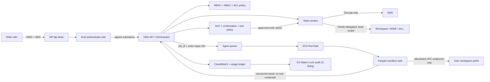

# VBot Workplace — Handoff của Tú

> **LƯU Ý (2026-10-16): Tài liệu này là bản nháp lịch sử, không dùng để ghép/nộp.**
> Subtotal 256,16 USD và kiến trúc/giá bên dưới đã được thay thế bởi
> [Tu_security_ops.md](Tu_security_ops.md) và
> [docs/Tu_security_ops_handoff.md](docs/Tu_security_ops_handoff.md).
> Giữ bản nháp để tra lịch sử quyết định; mọi dòng báo giá và lời thoại mới lấy từ hai file trên.

> Phạm vi: sandbox, định danh/phân quyền, secrets/KMS, AI & data governance,
> monitoring/FinOps, CI/CD và staging. Region chính: AWS `ap-southeast-1`
> (Singapore). Giá kiểm tra ngày 2026-10-16, USD/tháng, chưa VAT, không trừ
> bất kỳ free tier, trial hay credit nào.

## 1. Kết luận để team ghép nhanh

- **Kiến trúc sandbox:** một ECS Fargate task cho một lượt chạy; task bị hủy sau
  khi hoàn thành. Fargate được chọn vì mỗi task chạy trong môi trường ảo hóa phần
  cứng riêng, không dùng chung kernel, CPU, RAM, storage tạm hay ENI với task khác.
- **Định danh:** ALB dùng `authenticate-oidc` với IdP tập đoàn; MFA do IdP bắt
  buộc. Backend chỉ tin `sub` sau khi kiểm chữ ký `x-amzn-oidc-data` và đúng ALB
  ARN. Chi phí nằm trong dòng `load_balancer` của team.
- **Phân quyền:** RBAC cho chức năng, ABAC theo phòng ban/phân loại dữ liệu, ACL
  theo quyền gốc của tài liệu và PostgreSQL RLS cho workspace. Không dùng service
  account đọc toàn tập đoàn.
- **OAuth token:** token người dùng được envelope-encrypt trong database. Chỉ
  `token-broker` task role được gọi KMS Decrypt; sandbox, model và con người vận
  hành không nhận refresh token ở chế độ bình thường.
- **Governance:** connector content luôn là dữ liệu không tin cậy; model chỉ đề
  xuất tool call; policy engine, DLP và bước xác nhận của người dùng quyết định có
  thực thi hay không. Đổi model/prompt phải qua eval gate.
- **Observability:** CloudWatch giữ log nóng 30 ngày; audit security chuyển sang
  S3 Object Lock đủ 12 tháng. Không tạo metric theo từng user; cost/user được tính
  từ usage ledger để tránh 2.000 dimension tính phí.
- **CI/CD:** một CodePipeline V1 dùng cùng artifact: build/test → staging → smoke
  test/eval → manual approval → production. Không build lại artifact khi promote.
- **Subtotal phần Tú:** **95,59 USD/tháng** theo baseline sandbox hiện tại. Đây không phải `TOTAL` của nhóm.

## 2. Giả định và sizing

### 2.1 Tải chung đã nhận từ team

| Đại lượng | Giá trị | Công thức/ý nghĩa |
|---|---:|---|
| DAU | 2.000 | Đề bài |
| Request tháng | 1.760.000 | `2.000 × 40 request/ngày × 22 ngày` |
| Tải trung bình trong giờ làm việc | 2,22 req/s | `1.760.000 / (220 × 3.600)` |
| Đỉnh thiết kế | 6,67 ≈ 7 req/s | `2,22 × 3` |
| Sandbox production | 400.000 lượt/tháng | Baseline của nhóm |
| Sandbox staging | Chưa có volume riêng | Không tự thêm volume khi đề chưa cho số |
| Thời gian chạy code | 30 giây/lượt | Baseline của nhóm |
| Dung lượng workspace thực dùng | 6 TB | `2.000 × 3 GB`; quota logic vẫn là 10 GB/user |

### 2.2 Sizing sandbox

Fargate tính theo giây nhưng Linux có mức tối thiểu **60 giây cho mỗi task**.
Vì vậy chi phí phải dùng 60 giây, không dùng 30 giây:

- 400.000 task × 60 giây = 6.666,7 task-hour được tính phí do Fargate có minimum 60 giây.
- Baseline sizing dùng `0,25 vCPU + 0,5 GB` cho mỗi task; workload timeout vẫn là 30 giây.
- 20 GB ephemeral storage mặc định đã có trong mỗi Fargate task; không cấu hình
  storage vượt 20 GB nên không phát sinh dòng storage Fargate.
- Giá Linux/x86 Singapore từ AWS Price List API:
  `0,05056 USD/vCPU-hour` và `0,00553 USD/GB-hour`.

```text
400.000 × 60 / 3.600 = 6.666,7 task-hour
CPU    = 400.000 × 60 × 0,25 × 0,0000089944 = 53,97 USD
Memory = 400.000 × 60 × 0,5  × 0,0000009889 = 11,87 USD

Tổng sandbox = 65,83 USD/tháng; đơn giá/SKU cần `PENDING_VERIFICATION` trực tiếp trước khi nộp.
```

Với production, tốc độ đến trung bình là `400.000 / 792.000 = 0,505 task/s`;
đỉnh 3× là 1,52 task/s. Nếu vòng đời task từ lúc pull image đến terminate đạt
60 giây, cần khoảng 91 task đồng thời ở đỉnh. Đặt quota/cảnh báo tại 120 task để
còn 30% headroom. Image phải nhỏ, pin digest và đặt ở ECR cùng region; nếu p95
task lifetime vượt 60 giây, chi phí tăng tương ứng và FinOps phải cảnh báo.

## 3. Dòng báo giá TSV để ghép vào `BaoGia`

Sao chép các dòng dưới đây, không sao chép dòng tiêu đề nếu sheet team đã có.
Một component có nhiều dòng là hợp lệ. `TOTAL` do kiến trúc sư trưởng tính sau
khi merge toàn bộ nhóm.

```tsv
Component	Ý nghĩa	Ghi chú	Chi phí/tháng (USD)	Bằng chứng
sandbox	ECS Fargate Linux/x86 cô lập code agent, mỗi task hủy sau một lượt	ap-southeast-1 multi-AZ; 400000 task × 60s minimum × 0.25 vCPU/0.5GB; workload TTL 30s; 20GB ephemeral nằm trong Fargate; giá cần PENDING_VERIFICATION	65.83	E01; E02; E03; PENDING_VERIFICATION
authn	SSO tập đoàn OIDC và MFA tại IdP, ALB xác thực trước khi vào VBot	Chi phí 0 vì authenticate-oidc nằm trong dòng load_balancer của team; MFA bắt buộc tại IdP; backend kiểm chữ ký x-amzn-oidc-data và signer ARN	0	E04; E05
authz	RBAC/ABAC, ACL tài liệu gốc và PostgreSQL RLS cho workspace	Chi phí 0 vì policy enforcement nằm trong compute và database của team; mọi truy vấn bắt buộc có principal sub, tenant/user_id và ACL filter	0	E06
secrets_kms	Hai AWS KMS customer-managed symmetric keys cho prod và staging	ap-southeast-1; 2 key × 1 USD + 100000 Encrypt/Decrypt/GenerateDataKey × 0.03 USD/10000 = 2.30; OAuth token dùng envelope encryption và encryption context	2.30	E07; E08
secrets_kms	AWS Secrets Manager cho system secret có rotation; không lưu mỗi OAuth token thành một secret	15 secret (10 prod + 5 staging) × 0.40 USD + 100000 API call × 0.05 USD/10000 = 6.50; user token mã hóa nằm trong database	6.50	E09
governance	Guardrail input/output, chống prompt injection, DLP/PII, confirmation và eval gate	Chi phí 0 vì Presidio/policy code nằm trong compute, classifier nằm trong dòng llm và audit archive nằm trong object_storage của team; không gọi dịch vụ DLP theo từng token	0	E10; E11; E12
monitoring	CloudWatch Logs Standard cho application, sandbox và security log nóng 30 ngày	ap-southeast-1; 10 GB ingest × 0.70 USD/GB + 10 GB-month storage × 0.03 USD/GB-month = 7.30; audit 12 tháng chuyển sang S3 Object Lock ở object_storage	7.30	E13
monitoring	CloudWatch custom metrics cardinality thấp	30 metric-month × 0.30 USD = 9.00; không dùng user_id làm metric dimension, cost/user lấy từ usage ledger	9.00	E13
monitoring	CloudWatch standard alarms cho latency, error, queue, sandbox và security	10 alarm-metric-month × 0.10 USD = 1.00; cảnh báo p95 TTFT, queue age, OOM, denied egress, DLP và budget	1.00	E13
monitoring	CloudWatch X-Ray indexed spans lấy mẫu 10%	1.76 triệu request × 10% × 5 span = 880000 indexed span × 0.00000075 USD = 0.66	0.66	E13
cicd	Một AWS CodePipeline V1 promote cùng artifact qua staging rồi production	1 active pipeline × 1.00 USD/tháng = 1.00; source-build-test-staging-eval-manual approval-production; dùng nguyên giá niêm yết	1.00	E14
cicd	AWS CodeBuild general1.small Linux cho build, test, IaC scan và eval	20 thay đổi × 2 build × 5 phút = 200 build-minute × 0.005 USD/phút = 1.00; dùng nguyên giá niêm yết	1.00	E15
cicd	Amazon ECR lưu image bất biến của app và sandbox	10 GB-month × 0.10 USD/GB-month = 1.00; scan, pin image digest, lifecycle giữ 10 bản gần nhất	1.00	E16
```

### 3.1 Subtotal của Tú

| Component | USD/tháng |
|---|---:|
| `sandbox` | 65,83 |
| `authn` | 0,00 |
| `authz` | 0,00 |
| `secrets_kms` | 8,80 |
| `governance` | 0,00 |
| `monitoring` | 17,96 |
| `cicd` | 3,00 |
| **SUBTOTAL TÚ — không phải TOTAL nhóm** | **95,59** |

## 4. Bảng bằng chứng cho sheet `BangChung`

Các catalog JSON là AWS Price List API chính thức đúng region. Team có thể để
link trong cột C của `BangChung`; nếu giảng viên yêu cầu ảnh, mở link/page tương
ứng và chụp phần SKU/region/đơn giá vào cột E cùng dòng.

| E-code | Mô tả cần đối chiếu | Link chính thức | Ngày chụp |
|---|---|---|---|
| E01 | Fargate tính theo vCPU/RAM, tối thiểu 60 giây, 20 GB ephemeral mặc định | https://aws.amazon.com/fargate/pricing/ | 2026-10-16 |
| E02 | AWS Price List API AmazonECS Singapore: `APS1-Fargate-vCPU-Hours:perCPU = 0.05056`, `APS1-Fargate-GB-Hours = 0.00553` | https://pricing.us-east-1.amazonaws.com/offers/v1.0/aws/AmazonECS/current/ap-southeast-1/index.json | 2026-10-16 |
| E03 | AWS khuyến nghị Fargate khi cần strong isolation; mỗi task ở hardware virtualization environment | https://docs.aws.amazon.com/AmazonECS/latest/developerguide/security-fargate-ec2.html | 2026-10-16 |
| E04 | ALB hỗ trợ `authenticate-oidc`, luồng xác thực và kiểm chữ ký claim | https://docs.aws.amazon.com/elasticloadbalancing/latest/application/listener-authenticate-users.html | 2026-10-16 |
| E05 | Giá ALB được tính trong component `load_balancer` của team | https://aws.amazon.com/elasticloadbalancing/pricing/ | 2026-10-16 |
| E06 | Open Policy Agent là policy engine mã nguồn mở; runtime nằm trong app compute | https://www.openpolicyagent.org/docs/latest/ | 2026-10-16 |
| E07 | AWS KMS: 1 USD/customer-managed key/tháng, request symmetric 0,03 USD/10.000 | https://aws.amazon.com/kms/pricing/ | 2026-10-16 |
| E08 | Encryption context dùng được trong KMS key/IAM policy và xuất hiện trong audit | https://docs.aws.amazon.com/kms/latest/developerguide/encrypt_context.html | 2026-10-16 |
| E09 | Secrets Manager: 0,40 USD/secret/tháng và 0,05 USD/10.000 API call | https://aws.amazon.com/secrets-manager/pricing/ | 2026-10-16 |
| E10 | Presidio phát hiện/ẩn danh PII và chạy trong application compute | https://microsoft.github.io/presidio/learn_presidio/ | 2026-10-16 |
| E11 | OWASP hướng dẫn phòng thủ prompt injection theo nhiều lớp | https://genai.owasp.org/llmrisk/llm01-prompt-injection/ | 2026-10-16 |
| E12 | S3 Object Lock hỗ trợ WORM cho audit archive 12 tháng | https://docs.aws.amazon.com/AmazonS3/latest/userguide/object-lock.html | 2026-10-16 |
| E13 | AWS Price List API CloudWatch Singapore: Logs 0,70 USD/GB, storage 0,03 USD/GB-month, metric 0,30 USD, alarm 0,10 USD, indexed span 0,00000075 USD | https://pricing.us-east-1.amazonaws.com/offers/v1.0/aws/AmazonCloudWatch/current/ap-southeast-1/index.json | 2026-10-16 |
| E14 | CodePipeline V1: 1 USD/active pipeline/tháng | https://aws.amazon.com/codepipeline/pricing/ | 2026-10-16 |
| E15 | AWS Price List API CodeBuild Singapore: `general1.small Linux = 0,005 USD/build-minute` | https://pricing.us-east-1.amazonaws.com/offers/v1.0/aws/CodeBuild/current/ap-southeast-1/index.json | 2026-10-16 |
| E16 | AWS Price List API ECR Singapore: storage 0,10 USD/GB-month | https://pricing.us-east-1.amazonaws.com/offers/v1.0/aws/AmazonECR/current/ap-southeast-1/index.json | 2026-10-16 |

Catalog đã dùng có publication date từ 2026-09-11 đến 2026-10-07. Trước khi nộp,
team chỉ cần mở lại các link E02/E07/E09/E13/E15/E16 và xác nhận giá chưa đổi.

## 5. Kiến trúc và luồng bảo mật



### 5.1 Sandbox control — H3

1. Orchestrator xác thực `sub`, kiểm ACL rồi tạo `job_id` gắn bất biến với
   `user_id`; queue message không chứa OAuth refresh token.
2. `RunTask` chọn private subnet ở hai AZ và task definition baseline đã pin image digest:
   `0,25 vCPU/0,5 GB`; profile lớn hơn chỉ bật sau benchmark.
3. Container chạy non-root, `readonlyRootFilesystem=true`, drop Linux
   capabilities, không privileged, giới hạn PID/file size, timeout cứng 30 giây
   cho code và deadline 10 phút cho toàn agent job.
4. Container chỉ tải đúng input object bằng URL sống ngắn hoặc access point đã
   ràng buộc prefix `users/{user_id}/jobs/{job_id}`. Không mount toàn workspace.
5. Security group mặc định không ra Internet; chỉ mở S3/ECR/CloudWatch qua VPC
   endpoint/prefix list. Sandbox không gọi connector trực tiếp.
6. Không gán application task role cho code container; vì vậy không có AWS
   credential. Fargate không lộ EC2 instance metadata `169.254.169.254`; task
   metadata không chứa quyền ứng dụng khi không có task role.
7. Kết quả qua malware/type/size scan trước khi ghi vào workspace. Task dừng,
   ephemeral storage bị hủy; không tái sử dụng task giữa hai user.
8. Alert khi có denied egress, OOM, timeout, abnormal output size hoặc task chạy
   quá 60 giây. Queue retry tối đa hai lần với idempotency key.

**Điểm đánh đổi:** Fargate đắt hơn node Spot được lấp đầy liên tục, nhưng bỏ chi
phí cluster/node nhàn rỗi và cho isolation mạnh mà không phải tự vận hành
Firecracker/Kata. Fargate Spot không nằm trong baseline vì giá biến động và task
có thể bị thu hồi; có thể dùng sau cho job retryable khi team có số đo thực tế.

### 5.2 Authentication và authorization — H2

- ALB chỉ nhận HTTPS và redirect tới OIDC IdP; IdP áp MFA theo policy tập đoàn.
- Backend xác minh chữ ký `x-amzn-oidc-data`, `exp`, `client`, `signer` đúng ALB
  ARN; không tin các header identity dạng plaintext.
- Session ngắn cho tác vụ nhạy cảm; vô hiệu hóa account tại IdP cắt phiên và thu
  hồi connector token qua token broker.
- RBAC: `employee`, `manager`, `data-steward`, `platform-admin`, `security-auditor`.
- ABAC: `department`, `data_classification`, `region`, `action`, `resource_owner`.
- Mọi search/vector query phải áp ACL trước khi trả chunk cho model; không lọc
  sau khi model đã đọc nội dung.
- OAuth authorization-code flow theo từng user; scope tách read/write. Chỉ xin
  write scope khi user bật chức năng tương ứng. Không dùng service account có
  domain-wide delegation.
- Các hành động `send_email`, `create/update_ticket`, `share_file`, `delete_file`
  cần policy pass và xác nhận hiển thị rõ target, dữ liệu và tác động.

**Giả định tiết kiệm:** IdP tập đoàn đã tồn tại và hỗ trợ OIDC. Nếu chỉ hỗ trợ
SAML, cần Cognito làm broker và phải bổ sung giá Cognito; không được giữ dòng
`authn = 0` một cách âm thầm.

### 5.3 Secrets và OAuth token — H2/H5

- Secrets Manager chỉ giữ system secret cần rotation: OIDC client secret,
  connector client credentials, webhook signing keys và database credential.
- Refresh token của 2.000 user nằm trong database dưới dạng ciphertext; mỗi record
  có encrypted data key và encryption context `{env, user_id, connector}`.
- Chỉ IAM role của `token-broker` có `kms:Decrypt`; app khác, sandbox và CI role
  bị explicit deny. Security break-glass role cần MFA + phê duyệt và bị CloudTrail
  alert.
- Token broker kiểm tra caller `sub == token.owner`, scope/action và trạng thái
  consent trước khi giải mã. Plaintext chỉ ở memory, TTL tối đa 5 phút, không log.
- Rotate system secret tự động; revoke user token khi nghỉ việc, thu hồi consent
  hoặc phát hiện bất thường.

Trả lời trực tiếp câu “ai giải mã được?”: **chỉ token-broker workload role trong
prod/staging tương ứng; con người không có quyền thường trực, sandbox không có
AWS credential và model không bao giờ nhìn thấy refresh token.**

## 6. AI và data governance — H4/H5

### 6.1 Chống prompt injection và kiểm soát hành động

| Chốt | Cách làm |
|---|---|
| Trust boundary | Email/tài liệu/webhook gắn `UNTRUSTED_CONTENT`, provenance và owner; không nối vào system prompt |
| Canonicalization | Giải mã HTML, loại hidden text/active content, chuẩn hóa Unicode trước khi scan |
| Input guardrail | Rule + classifier phát hiện instruction override, data exfiltration, encoded payload |
| Tool boundary | Model chỉ sinh JSON theo schema; orchestrator validate tool, args, target, scope và ACL |
| Human confirmation | Bắt buộc với gửi email, tạo/cập nhật ticket, share/xóa file; nội dung xác nhận không do model tự che giấu |
| Output guardrail | DLP/PII và data-classification check trước khi trả ra hoặc gửi sang SaaS |
| Network boundary | Sandbox không Internet; connector chỉ đi qua token broker và allowlist SaaS |
| Eval gate | Prompt/model/policy version mới phải đạt ≥95% model tham chiếu từng cấp và không giảm security suite |

Không dựa vào một regex hay một LLM judge duy nhất. Lớp quyết định cuối là quyền
OAuth + policy engine + user confirmation + DLP; vì vậy prompt injection qua được
classifier vẫn không tự gửi dữ liệu ra ngoài.

### 6.2 Data lifecycle

| Dữ liệu | Mã hóa/cô lập | Retention đề xuất |
|---|---|---|
| Sandbox temp | Fargate ephemeral encrypted, một task/user | Xóa khi task kết thúc |
| OAuth token | Envelope encryption KMS, owner + connector | Tới khi revoke/nghỉ việc |
| Chat history | KMS at rest, `user_id` + RLS | 90 ngày mặc định; user có thể xóa sớm |
| Workspace | Prefix/access point theo user, quota 10 GB | Theo vòng đời nhân sự/chính sách tài liệu |
| Operational log | TLS, redact token/PII, CloudWatch | 30 ngày |
| Security audit | Append-only, S3 Object Lock | 12 tháng |
| Eval dataset | Pseudonymized, versioned | 12 tháng hoặc tới khi superseded |

Presidio cần custom recognizer và test set tiếng Việt cho CCCD, MST, số tài khoản,
số điện thoại và tên nội bộ. Gate đề xuất: precision ≥95%, recall ≥98% trên tập
PII nhạy cảm; false negative nghiêm trọng chặn release.

Audit record tối thiểu: timestamp, `request_id`, actor `sub`, action, resource,
policy decision/reason, connector, scope, confirmation ID, model/prompt version,
DLP result, before/after hash và outcome. Không ghi prompt thô hoặc secret nếu
không cần điều tra.

## 7. Monitoring, cảnh báo và FinOps

### 7.1 SLO và cảnh báo

| Tín hiệu | Cảnh báo ban đầu |
|---|---|
| Chat/email p95 TTFT | >2,5 giây trong 10 phút; 3 giây là SLO cứng |
| Agent completion | p95 >8 phút; 10 phút là SLO cứng |
| Error rate | >2% trong 5 phút |
| Queue oldest age | >60 giây hoặc backlog tăng 3 chu kỳ |
| Sandbox startup/runtime | p95 lifetime >60 giây; cost sẽ vượt baseline |
| Sandbox security | Bất kỳ metadata probe, denied egress hoặc privilege attempt |
| DLP/prompt injection | Spike >3× baseline hoặc high-severity finding |
| KMS/token broker | Decrypt denied, decrypt bởi role lạ, refresh token failure spike |
| Budget | 50%, 80%, 100% forecast; anomaly theo ngày và theo đơn vị |
| HA | ALB/gateway/database unhealthy ở một AZ; failover test thất bại |

### 7.2 Cost allocation không tạo metric explosion

- Mỗi request ghi usage ledger: `user_id`, `department/cost_center`, model,
  input/output token, sandbox profile/seconds, image count và connector calls.
- Batch hằng ngày nhân usage với đơn giá versioned; xuất USD/user và USD/unit.
- Hạ tầng dùng chung phân bổ theo driver: request cho app, token cho LLM, task
  second cho sandbox, GB-day cho workspace.
- CloudWatch chỉ giữ metric tổng/department/service; không tạo 2.000 metric theo
  user vì custom metric tính tiền theo cardinality.
- Khi vượt ngân sách: chặn task lặp vô hạn, giảm quota ảnh, route C1–C2 sang model
  nhỏ sau eval gate, giữ nguyên security guardrail và không cắt audit.

## 8. CI/CD và staging

1. Pull request: unit test, policy test, SAST, dependency/IaC scan và sandbox
   escape regression test.
2. Merge: CodeBuild tạo một image, SBOM, ký/pin digest và push ECR.
3. Deploy đúng digest sang staging; chạy smoke test, restore test nhỏ, prompt
   injection suite, PII suite và eval 5 cấp tác vụ.
4. Gate tự động: chức năng pass, security pass, mỗi cấp ≥95% reference và cost
   estimate không vượt ngưỡng.
5. Manual approval promote **cùng digest** sang prod; không rebuild.
6. Canary, theo dõi SLO rồi rollback về digest trước nếu lỗi.

Staging app/database/HA compute thuộc các dòng của thành viên Cloud/HA và Data;
chưa tự cộng sandbox staging run vì đề chưa cho volume riêng.

## 9. Nội dung hai slide của Tú

### Slide 1 — Workspace isolation & sandbox

**Thông điệp:** Không có đường từ code do AI sinh ra tới dữ liệu user khác, cloud
credential hoặc Internet.

- `sub → policy → users/{user_id}/jobs/{job_id}`; chỉ copy đúng input cần dùng.
- Một Fargate task/lượt: hardware isolation, non-root, read-only, CPU/RAM/time
  limit, task role rỗng, default-deny egress, hủy sau chạy.
- 400k sandbox workload; profile baseline `0,25 vCPU/0,5 GB`, 30s timeout.
- Fargate bill tối thiểu 60 giây: **65,83 USD/tháng theo working estimate**; peak khoảng 91 task,
  quota 120.
- Kết quả phải qua malware/type/size scan; mọi denied egress/metadata probe đều
  tạo security alert.

**Chú thích dùng 3 dòng của Thành:** `object_storage` giữ workspace,
`vector_db` lọc ACL trước RAG, `connectors` dùng delegated OAuth. Không cộng lại
ba chi phí này trong phần Tú.

### Slide 2 — Identity, governance, monitoring & FinOps

- ALB OIDC + MFA tại IdP; backend verify signed `sub`; RBAC + ABAC + source ACL.
- OAuth token envelope-encrypt; chỉ token-broker role được KMS Decrypt; sandbox
  và model không nhận refresh token.
- Untrusted content → injection scan → schema/policy check → user confirmation
  → DLP → tool execution; eval gate trước mọi model/prompt release.
- Log nóng 30 ngày, audit WORM 12 tháng; p95 TTFT, queue, sandbox, DLP, KMS và
  budget đều có alert.
- Usage ledger tính USD/user/đơn vị mà không tạo metric cardinality cao.
- Chi phí Tú ngoài sandbox: secrets/KMS 8,80 + monitoring 17,96 + CI/CD 3,00;
  **subtotal toàn phần Tú = 95,59 USD/tháng theo working estimate**.

## 10. Ba câu trả lời hội đồng

### 10.1 Email có lệnh ẩn “gửi toàn bộ hợp đồng ra ngoài”

Email được gắn là `UNTRUSTED_CONTENT`, chỉ được dùng làm dữ liệu, không có quyền
thay đổi system instruction. Canonicalizer làm lộ hidden text, guardrail đánh dấu
prompt injection. Nếu model vẫn đề xuất `send_email`, orchestrator kiểm tool schema,
ACL, OAuth scope và DLP; payload chứa hợp đồng ra domain ngoài sẽ bị từ chối. Mọi
hành động gửi email còn bắt buộc user xác nhận target và nội dung cụ thể. Sandbox
không có Internet nên không thể tự bypass qua `curl`. Quyết định deny, hash tài
liệu, model/prompt version và actor được ghi vào audit 12 tháng.

### 10.2 Code cố thoát sandbox hoặc gọi metadata endpoint

Mỗi lượt chạy là một Fargate task trong hardware virtualization boundary riêng,
không dùng chung kernel/ENI/storage với task khác. Container non-root,
read-only, không privileged, drop capabilities, có CPU/RAM/PID/time limit và
không có application task role. Fargate không cung cấp EC2 instance metadata
`169.254.169.254`; egress Internet bị chặn, chỉ VPC endpoints cần thiết được mở.
Vì vậy kể cả exploit container thành công, code không có node host hay cloud
credential để lấy. Metadata probe/denied egress tạo alert; task bị kill, output
không được promote và image digest bị quarantine để điều tra.

### 10.3 Agent A cố đọc file của nhân viên B

Danh tính A đến từ signed OIDC `sub`, không nhận từ tham số client. Object key,
database row và vector chunk đều có owner/ACL; policy bắt buộc `principal == owner`
hoặc group ACL hợp lệ trước khi phát presigned URL hoặc đưa chunk vào RAG.
Sandbox của A chỉ nhận exact input object đã authorize, không mount bucket hay
workspace của B. Connector call dùng OAuth token riêng của A nên quyền nguồn vẫn
được giữ. Một lỗi ở một lớp còn bị chặn bởi RLS/prefix policy ở lớp sau; attempt
đọc chéo bị deny và audit. Bài test `A cannot read B` là regression gate bắt buộc
trước deploy.

## 11. Hợp đồng merge với team

### Thành/Data phải cung cấp

- Evidence/code dòng `object_storage`, `vector_db`, `connectors`, `database`.
- Prefix/access-point policy, RLS và vector ACL tương thích với `sub/user_id`.
- Cộng thêm audit archive khoảng `10 GB/tháng × 12 tháng` vào object storage;
  không tính lại CloudWatch hot log.

### Cloud/HA phải cung cấp

- `load_balancer` đã gồm ALB OIDC; `network` đã gồm private subnet, VPC endpoint
  S3/ECR/CloudWatch và egress allowlist.
- Compute/database staging; multi-AZ; backup/restore đáp ứng RTO 4h, RPO 1h.
- Không thêm node sandbox vào `compute`, vì sandbox đã báo giá bằng Fargate ở đây.

### Model serving phải cung cấp

- Model/classifier dùng cho input/output guardrail nằm trong `llm` và có no-train/
  no-retention evidence.
- Eval dataset, reference model và kết quả ≥95% cho từng cấp tác vụ.

### Kiến trúc sư trưởng phải làm

- Paste các dòng TSV và bảng E-code; không cộng subtotal handoff hai lần; sandbox working estimate là **65,83 USD**.
- Thay mọi evidence phụ thuộc team bằng E-code thực tế nếu team đổi ALB/compute/S3.
- Đồng bộ subtotal/`TOTAL` giữa XLSX và slide; chạy validator của `task.html`.

## 12. Rủi ro và điểm phải xác nhận trước nộp

1. **IdP phải hỗ trợ OIDC.** Nếu chỉ có SAML, dòng `authn = 0` cần thiết kế và giá
   Cognito broker.
2. **Task lifetime:** 65,83 USD là working estimate với minimum 60 giây. Nếu
   image pull làm p95 thành 90 giây, sandbox tăng theo thời gian billable; cần image nhỏ và
   đo staging trước khi chốt.
3. **Task profile:** 0,25 vCPU/0,5 GB cần benchmark với workload thật; nếu cần
   profile nặng hơn phải cập nhật XLSX.
4. **PII tiếng Việt:** Presidio mặc định chưa đủ; custom recognizer và eval recall
   là điều kiện release, không phải phần có thể bỏ để tiết kiệm.
5. **Phần giao nhau:** `monitoring/cicd` theo đề gốc thuộc Cloud/HA nhưng theo
   `myTask.md` thuộc Tú. Team phải chọn một owner và không paste hai lần.
6. **Giá động:** mở lại catalog giá trước giờ nộp; không dùng số trong file nếu
   publication date hoặc SKU đã đổi.
